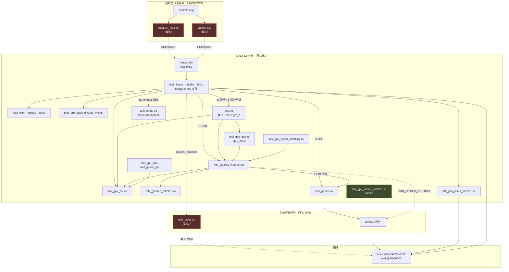
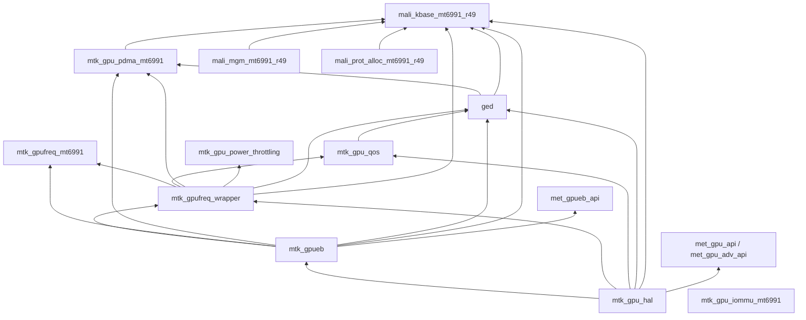
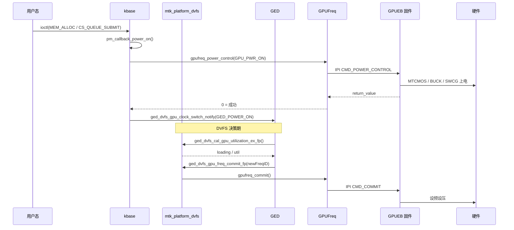
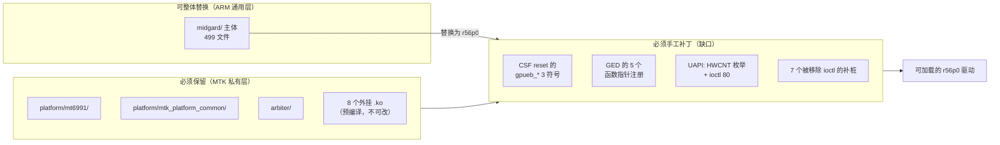

# K80U 原厂 GPU 驱动依赖关系审计（TASK 01-C）

> 项目：K80U_GPU_R56_AUDIT — Redmi K80 至尊版（25060RK16C）/ MT6991 / Immortalis-G925 MC12
> 执行日期：2026-11-15
> 性质：**只读**。未修改代码、未编译、未运行。
> 证据等级：`[S]` 二进制符号表实测（`readelf`）；`[C]` 源码调用点（文件:行号）；`[D]` 设备树/配置；`[I]` 由上述推出的架构结论；`[UNKNOWN]` 证据不足。

---

## 0. 摘要：八问八答

| # | 问题 | 结论 | 强度 |
| --- | --- | --- | --- |
| 1 | Android 图形系统如何调用 GPU 用户态驱动？ | 内核侧唯一入口是 **`/dev/mali0` + ioctl 类型 `0x80`**；用户态如何分层（libGLES→libmali）**无法确认**，因 blobs 缺失 | `[C]` + `[UNKNOWN]` |
| 2 | GLES 与 Vulkan 是否共用驱动组件？ | **无法确认**。可从 PanVK 实证"Vulkan 可绕过 libmali 直连 kbase"，但原厂是否共用**无证据** | `[UNKNOWN]` |
| 3 | 用户态如何与 Kbase 通信？ | `open(/dev/mali0)` → `IOCTL_VERSION_CHECK`（UK 协商）→ `SET_FLAGS` → 后续 ioctl | `[C]` |
| 4 | Kbase 如何调用 GED？ | **49 个 `ged_*` 未定义符号**；且是双向：kbase 把 5 个函数指针**写入** GED 的全局指针，GED 回调 | `[S]` + `[C]` |
| 5 | GPUEB 与 Kbase、GPUFreq 的关系？ | GPUEB 是**独立协处理器**，对 kbase **零符号依赖**；kbase 只在 GPU reset 路径用 3 个 `gpueb_*` 符号；GPUFreq 通过 **IPI（19 条命令）** 驱动 GPUEB | `[S]` + `[C]` |
| 6 | 电源/时钟/频率/IOMMU 各由谁管？ | 电源+电压+频率 → **GPUFreq → IPI → GPUEB**；IOMMU → **ARM SMMUv3 通用驱动**（MTK 的 `mtk_gpu_iommu_mt6991.ko` 是空壳）；kbase 的 devfreq/regulator 路径被 MTK 旁路 | `[C]` |
| 7 | CSF 固件从哪加载？ | `request_firmware("mali_csffw.bin", kbdev->dev)` → 标准 firmware loader；dts 无 `firmware-name` 属性，故用默认名 | `[C]` + `[D]` |
| 8 | 哪些是 ARM 通用、哪些是 MTK 私有？ | ARM 通用 = `midgard/` 主体；MTK 私有 = `platform/mt6991/`(3) + `platform/mtk_platform_common/`(64) + `arbiter/`(6) + 8 个外挂 `.ko` + **87 个 `CONFIG_MALI_MTK_*` 开关**；**94 个 ARM 原版文件被 MTK 代码侵入** | `[C]` |

**对 R56 替换的总体判断**：内核驱动层可换，**平台适配层不可直接复用**。头号障碍不是 ioctl 号冲突（MTK 用 80，R56 未占用），而是 **`mali_platform_dvfs.c` 对 GED 的 5 个函数指针注册**与 **CSF reset 路径对 `gpueb_*` 的 3 个符号依赖**——这两处在 r56p0 中不存在对应实现。

---

## 1. 证据方法

| 手段 | 覆盖对象 | 说明 |
| --- | --- | --- |
| `readelf -sW` 未定义符号 | 15 个 `.ko` | 反映**真实链接依赖**，不受源码注释误导 |
| `readelf -sW` 导出符号 | 同上 | 反映**对外提供的能力** |
| 源码 `grep` 定位调用点 | R2 `mali-r49p1`、R3 GPU 子树 | 每条结论附 `文件:行号` |
| ioctl 集合差集 | r49p1 vs r56p0 UAPI 头 | `comm` 对比，精确到名字 |
| 设备树 / defconfig | `mt6991.dts`、`mgk_64_k66_defconfig` | 硬件绑定与编译开关 |

> **不做文件名推测**。凡本报告出现"A 调用 B"，必有符号表或源码行号；凡只有文件名相似而无调用证据的，一律不写。

---

## 2. 问题一：Android 图形系统如何调用 GPU 用户态驱动

### 2.1 能确认的部分（内核侧）

**唯一入口：`/dev/mali0` 字符设备。**

| 项 | 证据 |
| --- | --- |
| 设备名 | `mali_kbase.h:88` → `#define KBASE_DRV_NAME "mali"` |
| 注册方式 | `device/mali_kbase_device.c:462` → `int kbase_device_misc_register(...) { return misc_register(&kbdev->mdev); }` |
| 后端选择 | `device/backend/mali_kbase_device_csf.c:362` 注册 `{ kbase_device_misc_register, kbase_device_misc_deregister, … }`（CSF 后端） |
| 设备操作集 | `mali_kbase_core_linux.c:2475-2486` → `kbase_fops`：`open/release/read/poll/unlocked_ioctl/mmap/check_flags/get_unmapped_area` |
| ioctl 类型号 | `mali_kbase_ioctl.h:38` → `#define KBASE_IOCTL_TYPE 0x80` |

`[C]` 全部实证。

### 2.2 无法确认的部分

| 事项 | 状态 | 原因 |
| --- | --- | --- |
| libGLES_mali.so 内部如何分层（EGL→GLES→kbase backend） | `[UNKNOWN]` | 该 `.so` 不在任何已获取仓库；R5 全量 1,585 条清单 0 命中 |
| Android 侧是走 gralloc/`libui` 还是直接 ioctl | `[UNKNOWN]` | 同上 |
| 是否存在 HIDL/AIDL 中间层（如 `android.hardware.graphics.mapper`） | `[UNKNOWN]` | 无 vendor 镜像可查 |

> **不做无证据推断**。Mali 用户态分层是公开常识，但本审计只认本机可验证的证据，故标 UNKNOWN。

### 2.3 可确认的通信序列（内核侧视角）

```
用户态进程
  │ open("/dev/mali0")                    → kbase_open()          [core_linux.c]
  │ ioctl(0x80, KBASE_IOCTL_VERSION_CHECK) → kbase_api_handshake() [core_linux.c:461]
  │   └─ version->minor = min_t(int, BASE_UK_VERSION_MINOR, version->minor)
  │      ↑ 向下兼容协商：内核把 minor 降到双方都支持的最低值
  │ ioctl(0x80, KBASE_IOCTL_SET_FLAGS)     → kbase_api_set_flags()  [建 kctx]
  │ ioctl(0x80, KBASE_IOCTL_GET_GPUPROPS)  → kbase_api_get_gpuprops()
  │ ── 此后 setup 完成，进入 normal ioctl ──
  │ ioctl(0x80, KBASE_IOCTL_MEM_ALLOC/…)   → 内存管理
  │ ioctl(0x80, KBASE_IOCTL_CS_QUEUE_*)    → CSF 队列（仅 MALI_USE_CSF=1）
  │ mmap(/dev/mali0)                        → kbase_mmap()  [GPU VA 映射]
```

证据：`mali_kbase_core_linux.c:1964-2040` 的 `kbase_ioctl()` 两段式 switch——前段为 setup 前可用，后段需 `kbase_file_get_kctx_if_setup_complete()` 成功。

**协商逻辑的关键代码**（`core_linux.c:464-478`）：

```c
switch (version->major) {
case BASE_UK_VERSION_MAJOR:
    version->minor = min_t(int, BASE_UK_VERSION_MINOR, (int)version->minor);
    break;
default:
    version->major = BASE_UK_VERSION_MAJOR;
    version->minor = BASE_UK_VERSION_MINOR;   /* 不匹配则原样返回，由用户态决定是否退出 */
}
```

---

## 3. 问题二：GLES 与 Vulkan 是否共用驱动组件

### 3.1 结论：`[UNKNOWN]`

不能确认。原因：`libGLES_mali.so`、Vulkan ICD（`libvk*.so` / `vulkan.mali.so`）均**不在**已获取的 6 个仓库中。

### 3.2 唯一可用的间接证据

`00_reference/third_party/panvk-kbase-android/` 是第三方 Mesa PanVK 的 kbase 后端。它证明：**Vulkan 驱动可以绕开厂商 libmali，直接对 `/dev/mali0` 发 ioctl**。`[C]`（该仓存在 12 个 kbase 对接 patch）

但这是**第三方实现**，不能反推小米原厂是否让 GLES 与 Vulkan 共用同一份 libmali。

> 若后续拿到 vendor 分区，验证路径：
> ```bash
> adb shell 'ls -l /vendor/lib64/egl/ /vendor/lib64/hw/vulkan.*.so'
> adb shell 'readelf -d /vendor/lib64/egl/libGLES_mali.so | grep NEEDED'
> ```
> 若 Vulkan ICD 与 `libGLES_mali.so` 是同一文件（或互为 NEEDED），则共用成立。

---

## 4. 问题三：用户态与 Kbase 的通信协议

### 4.1 协议面：63 个 ioctl（r49p1）

| 分类 | 数量 | 代表 |
| --- | ---: | --- |
| 握手/配置 | 4 | `VERSION_CHECK`(0), `SET_FLAGS`(1), `GET_GPUPROPS`(3), `GET_DDK_VERSION` |
| 内存 | 14 | `MEM_ALLOC`(5), `MEM_QUERY`(6), `MEM_IMPORT`, `MEM_ALIAS`, `MEM_JIT_*` |
| CSF 队列 | 20+ | `CS_QUEUE_REGISTER`, `CS_QUEUE_BIND`, `CS_QUEUE_GROUP_CREATE`, `CS_EVENT_*` |
| 性能计数 | 2 | `KINSTR_PRFCNT_ENUM_INFO`(56), `KINSTR_PRFCNT_SETUP`(57) |
| **MTK 私有** | **1** | `INTERNAL_FENCE_WAIT`(**80**) |
| 其他 | — | `GET_CPU_GPU_TIMEINFO`, `FENCE_VALIDATE`, `TLSTREAM_*` |

### 4.2 MTK 私有 ioctl（关键）

`include/uapi/gpu/arm/midgard/mali_kbase_ioctl.h:662-663`：

```c
#define KBASE_IOCTL_INTERNAL_FENCE_WAIT \
	_IOW(KBASE_IOCTL_TYPE, 80, struct kbase_ioctl_internal_fence_wait)
```

结构体（同文件 654-659）：

```c
struct kbase_ioctl_internal_fence_wait {
	__u32 pid;
	__u32 flags;
	__u64 time_in_microseconds;
	__u64 queue;
};
```

处理点：`mali_kbase_core_linux.c:2264` → `case KBASE_IOCTL_INTERNAL_FENCE_WAIT:`。

**这个 ioctl 在 r56p0 中不存在**（全树 grep `INTERNAL_FENCE_WAIT` 0 命中），它是 MTK 为 fence 调试/超时检测加的私有通道。用户态 blobs 一旦调用它，换 r56p0 原生驱动会直接返回 `-ENOTTY`。

**编号冲突核查**（重要，避免误判）：

| 版本 | 编号 80 是否被占用 |
| --- | --- |
| r49p1 | 被 `INTERNAL_FENCE_WAIT` 占用 |
| **r56p0** | **未占用**（编号实际使用集合：0,1,3,5-7,13-25,27,29-31,36-54,56-63） |

> 结论：**当前不冲突**，MTK 私有 ioctl 可原样搬到 r56p0。但 80 属未分配区，ARM 后续版本有占用风险，移植时应改用 `KBASE_IOCTL_EXTRA_TYPE` 段或显式文档化。

---

## 5. 问题四：Kbase 如何调用 GED

### 5.1 符号级证据（最强）

| 方向 | 符号数 | 实测命令 |
| --- | ---: | --- |
| kbase → ged（未定义） | **49** | `readelf -sW mali_kbase_mt6991_r49.ko \| awk '$7=="UND"' \| grep '^ged_'` |
| ged → kbase（未定义） | **0** | 同上，对 `ged.ko` 执行 |
| ged 导出 `ged_*` | **378** | `readelf -sW ged.ko \| awk '$7!="UND" && $5=="GLOBAL"'` |
| ged 导出总函数符号 | 593 | 同上，不限前缀 |

> **`ged.ko` 对 `kbase`/`mali` 的反向链接依赖为 0**。这是硬结论：GED 完全独立于 Mali 驱动。

### 5.2 调用机制：不是普通函数调用，而是"指针注入 + 回调"

`[C]` `platform/mtk_platform_common/mtk_platform_dvfs.c:410-431`（`mtk_dvfs_init`）：

```c
#if IS_ENABLED(CONFIG_MALI_MIDGARD_DVFS) && IS_ENABLED(CONFIG_MALI_MTK_DVFS_POLICY)
	ged_dvfs_cal_gpu_utilization_ex_fp = mtk_common_cal_gpu_utilization_ex;
	mtk_notify_gpu_freq_change_fp        = MTKGPUFreq_change_notify;
	ged_dvfs_gpu_freq_commit_fp          = mtk_common_ged_dvfs_commit;
	ged_dvfs_gpu_freq_dual_commit_fp     = mtk_common_ged_dvfs_dual_commit;
	ged_dvfs_set_gpu_core_mask_fp        = mtk_set_core_mask;
	mtk_get_system_timer_fp              = mtk_common_get_system_timer;
#endif
	mtk_set_gpu_idle_fp = mtk_set_gpu_idle_time;
```

这些 `*_fp` 在 `mtk_platform_dvfs.h:45,54` 声明为 `extern` **函数指针变量**：

```c
extern void (*ged_dvfs_gpu_freq_commit_fp)(unsigned long ui32NewFreqID, …);
extern int  (*ged_dvfs_set_gpu_core_mask_fp)(u64 core_mask);
```

**即：kbase 把自己的实现写进 GED 的全局指针；GED 在做 DVFS 决策时反向回调 kbase。** 这就解释了为什么 `ged.ko` 的未定义符号里没有任何 `kbase_*`——它只操作指针。

另一类则是 kbase 直接调用 GED 函数，例如 `[.../backend/gpu/mali_kbase_pm_driver.c:1740]` → `ged_get_active_time();`。

### 5.3 49 个符号的功能分组

| 组 | 数量 | 代表符号 |
| --- | ---: | --- |
| DVFS 频点提交 | 6 | `ged_dvfs_gpu_freq_commit_fp`、`ged_dvfs_gpu_freq_dual_commit_fp`、`ged_dvfs_update_step_size` |
| 系统内存回写（sysram） | 8 | `ged_dvfs_write_sysram_last_commit_idx/_top_idx/_stack_idx/_dual` + 4 个 `_test` |
| 时间统计 | 5 | `ged_get_active_time`、`ged_get_idle_time`、`ged_get_predict_active_time` |
| APO（自适应功耗） | 6 | `ged_gpu_apo_support`、`ged_gpu_apo_notify`、`ged_gpu_apo_reset` |
| Mali 事件上报 | 6 | `ged_mali_event_init`、`ged_mali_event_notify_gpu_reset_done`、`ged_mali_event_update_device_lost_nolock` |
| 白盒/压测 | 8 | `ged_get_whitebox_power_test_case`、`ged_gpu_power_stress_test_enable` |
| 其他 | 10 | `ged_kpi_get_target_fps`、`ged_dvfs_gpu_clock_switch_notify`、`ged_check_predict_power_autosuspend` |

---

## 6. 问题五：GPUEB 与 Kbase、GPUFreq 的关系

### 6.1 定位：独立协处理器，不是"Mali 的一部分"

| 事实 | 证据 |
| --- | --- |
| GPUEB 对 kbase 零依赖 | `readelf -sW mtk_gpueb.ko \| awk '$7=="UND"' \| grep -c 'kbase\|mali'` → **0** `[S]` |
| GPUEB 导出 53 个函数符号 | 含 `gpueb_get_gpr_base`、`gpueb_ipi_init`、`gpueb_reserved_mem_init`、`gpueb_timesync_init` `[S]` |
| GPUEB 依赖 | `mtk_tinysys_ipi`、`mtk-mbox`（modinfo `depends=`） `[S]` |
| 设备树中断 | `mt6991.dts:7890` → `"GPUEB_MBOX1"`，`GIC_SPI 612` `[D]` |

### 6.2 Kbase → GPUEB：仅 3 个符号，且只在 reset 路径

| 符号 | 调用点 |
| --- | --- |
| `gpueb_get_mbox1_irq()` | `csf/mali_kbase_csf_reset_gpu.c:1081` |
| `gpueb_clr_mbox1_irq(BIT(0))` | 同文件 `:1112` |
| `gpueb_clr_mbox1_irq(BIT(1))` | 同文件 `:1114` |
| （注册中断） | `:1143` → `platform_get_irq_byname(pdev, "GPUEB_MBOX1")` |

`[C]`。这是**CSF 后端专属**的耦合——JM 后端没有这段。含义：GPU 复位时，kbase 需要经由 GPUEB 的 mailbox1 协商复位时序。

### 6.3 GPUFreq → GPUEB：IPI 命令通道（19 条）

`gpufreq/v2/include/gpufreq_ipi.h:22-42`：

```c
enum gpufreq_ipi_cmd {
	CMD_INIT_SHARED_MEM = 0,  CMD_GET_FREQ_BY_IDX = 1,  CMD_GET_POWER_BY_IDX = 2,
	CMD_GET_OPPIDX_BY_FREQ = 3, CMD_GET_LEAKAGE_POWER = 4, CMD_SET_LIMIT = 5,
	CMD_POWER_CONTROL = 6,    CMD_ACTIVE_SLEEP_CONTROL = 7, CMD_COMMIT = 8,
	CMD_DUAL_COMMIT = 9,      CMD_PDCA_CONFIG = 10,
	CMD_UPDATE_DEBUG_OPP_INFO = 11, … CMD_MSSV_COMMIT = 18, CMD_NUM = 19,
};
```

三者的实际关系（`[C]`，`gpufreq/v2/gpufreq_v2.c:770-780`）：

```c
if (g_gpueb_support && g_gpufreq_ready) {
	raw_spin_lock_irqsave(&gpufreq_ipi_lock, g_ipi_irq_flags);
	send_msg.cmd_id = CMD_POWER_CONTROL;
	send_msg.u.power_state = power;
	if (!gpufreq_ipi_to_gpueb(send_msg))
		ret = g_recv_msg.u.return_value;
	…
}
```

### 6.4 结论：三者不是"调用链"，而是"三角"

| 边 | 机制 | 是否共用内存 |
| --- | --- | --- |
| kbase ↔ GED | 函数指针双向注入 | 否（走 sysram 回写） |
| kbase ↔ GPUEB | 3 个直接函数 + mailbox1 中断 | 否 |
| GPUFreq ↔ GPUEB | IPI 19 条命令 + 共享内存（`gpueb_reserved_mem`） | **是** |

> GPUEB 运行的是**独立固件**（不在 Linux 源码内），GPUFreq 只是 IPI 客户端。

---

## 7. 问题六：电源、时钟、频率、IOMMU 的归属

### 7.1 归属总表

| 资源 | 实际管理者 | 证据 | kbase 的角色 |
| --- | --- | --- | --- |
| **电源（MTCMOS/SWCG/BUCK）** | GPUFreq → IPI → GPUEB | `platform/mt6991/mali_kbase_config_mt6991.c:149`：`/* on,off/ SWCG(BG3D)/ MTCMOS/ BUCK */` → `gpufreq_power_control(GPU_PWR_ON)` | 只发 `power_on_callback` 请求 |
| **电压** | OPP 表 + GPUEB | `mt6991.dts:7912` `gpu_mali_opp`（1,508 MHz@850 mV 起 20+ 档） | 不直接设压 |
| **频率** | GPUFreq → IPI `CMD_COMMIT` → GPUEB | `gpufreq_v2.c`；kbase 侧 `gpufreq_commit/dual_commit/set_limit` 共 16 个符号 | 提供 loading/利用率 |
| **时钟（clk）** | kbase 有 clk 句柄但被旁路 | `mali_kbase_core_linux.c:4998` `of_clk_get()`；`mali_kbase_devfreq.c:194` `clk_set_rate()` | 保留但 MTK 策略下不生效 |
| **IOMMU** | **ARM SMMUv3 通用驱动** | `mt6991.dts:10895` `compatible = "arm,smmu-v3", "mtk,smmu-v700", "mediatek,mt6991-gpu-smmu"` | 通过 `iommus` 属性绑定 |
| **`mtk_gpu_iommu_mt6991.ko`** | **空壳** | 全文 50 行，`probe()` 仅 `pr_info` + `return 0` | — |
| **Devfreq governor** | 被 MTK 策略替代 | 见 7.3 | — |

### 7.2 IOMMU 的真相（易误判点）

`gpu_iommu_mt6991.c` 的 `probe`/`remove` **只打印日志，不做任何硬件操作**：

```c
static int gpu_iommu_probe(struct platform_device *pdev)
{
	pr_info("[gpu_iommu] %s\n", __func__);
	return 0;
}
```

它唯一作用是绑定 dts 里 `gpu_protected_memory_allocator` 下的两个 `gpu-iommu` 子节点（`compatible = "mediatek,gpu-iommu"`），避免 `-EPROBE_DEFER`。

**真正的地址转换在 `iommu@48600000`**（`arm,smmu-v3` + `mtk,smmu-v700`），由内核 `drivers/iommu/arm/arm-smmu-v3/` 管理，**属 ARM/通用代码，不含 MTK 私有逻辑**（`mediatek,mt6991-gpu-smmu` 仅作 match 补充）。

> 结论：**IOMMU 层不是 R56 移植障碍**——它与 Mali 驱动版本无关。

### 7.3 kbase 自带路径被旁路的证据

| kbase 原生机制 | MTK 是否启用 | 证据 |
| --- | --- | --- |
| `CONFIG_MALI_MIDGARD_DVFS` 自带 governor | **被 `CONFIG_MALI_MTK_DVFS_POLICY` 接管** | `mtk_platform_dvfs.c:413` 的双重 `#if` 条件 |
| `regulator_enable()` | 仅 `platform/devicetree/`、`platform/meson/` 使用；**mt6991 不用** | `mt6991/mali_kbase_config_mt6991.c` 无 regulator 调用 |
| `pm_callbacks` | **全部由 MTK 实现**（`power_on/off/suspend/resume`），runtime 回调置 NULL | `mt6991/mali_kbase_config_mt6991.c:641-652` |

`pm_callbacks` 实测：

```c
struct kbase_pm_callback_conf pm_callbacks = {
	.power_on_callback  = pm_callback_power_on,
	.power_off_callback = pm_callback_power_off,
	.power_suspend_callback = pm_callback_suspend,
	.power_resume_callback  = pm_callback_resume,
	.power_runtime_init_callback = NULL,
	.power_runtime_term_callback = NULL,
	.power_runtime_on_callback   = NULL,
	.power_runtime_off_callback  = NULL,
	.power_runtime_gpu_idle_callback   = NULL,
	.power_runtime_gpu_active_callback = NULL,
};
```

> 注意：源码里存在 `pm_callback_runtime_on/off/gpu_active/gpu_idle` 四个函数（`:423,499,614,620`），但**未挂入 `pm_callbacks`**。属死代码或依赖外部配置。`[C]`

---

## 8. 问题七：CSF 固件从哪里加载

### 8.1 完整路径

| 步骤 | 代码位置 | 内容 |
| --- | --- | --- |
| 1. 默认文件名 | `csf/mali_kbase_csf_firmware.c:84` | `static char default_fw_name[...] = "mali_csffw.bin";` |
| 2. 可被模块参数覆盖 | 同文件 `:85` | `module_param_string(fw_name, default_fw_name, …, 0644);` |
| 3. 优先读设备树 | 同文件 `:2712` | `of_property_read_string(kbdev->dev->of_node, "firmware-name", &fw_name);` |
| 4. 请求固件 | 同文件 `:2735` | `request_firmware(&firmware, fw_name, kbdev->dev)` |
| 5. 解析镜像 | 同文件 `:2675` | `kbase_csf_firmware_load_init(kbdev)` → 逐 section 解析、校验、拷入 GPU 可见内存 |
| 6. 释放句柄 | 同文件 `:2751` | `release_firmware(firmware)` |

### 8.2 关键判定：dts 里**没有** `firmware-name`

`mt6991.dts:7874-7908` 的 mali 节点已完整读取，属性列表为：`compatible / reg / l2-hash-values / physical-memory-group-manager / interrupts / interrupt-names / protected-memory-allocator / operating-points-v2 / cooling-cells / system-coherency / dbg-force-sync / ged-supply / sleep-mode-enable / firmware-idle-hysteresis-time-us / default-glb-pwroff-timeout-us / autosuspend-delay-ms / adaptive-power-policy / reset-exception-mask / iter-trace-enable / gpu-frame-base-optimize / pbha`。

**无 `firmware-name`** → 走默认名 `mali_csffw.bin`。`[D]`

### 8.3 固件物理位置

`request_firmware()` 由内核 firmware loader 处理，搜索路径由 `CONFIG_EXTRA_FIRMWARE_DIR` 与 `fw_path` 决定，Android 上通常为 `/vendor/firmware/`、`/vendor_dlkm/etc/firmware/`。

| 事项 | 状态 |
| --- | --- |
| 固件内容 | **不在任何已获取仓库**（R5 清单 0 命中，Arm 原包内无） |
| 实际落盘路径 | `[UNKNOWN]`——需真机 `find / -name mali_csffw.bin` |
| 与 r56p0 的兼容性 | **`[UNKNOWN]`**——CSF 固件与内核驱动的接口版本必须匹配，r56p0 期望的固件接口版本与 r49p1 是否一致，无固件则无法判定 |

> 这是整条移植链的**唯一硬阻塞点**。

---

## 9. 问题八：ARM 通用 vs MTK 私有

### 9.1 划分依据

| 判据 | 结果 |
| --- | --- |
| 目录归属 | `midgard/` 主体 = ARM；`platform/mt6991/`、`platform/mtk_platform_common/`、`arbiter/` = MTK |
| 配置开关 | **87 个 `CONFIG_MALI_MTK_*`** |
| 代码侵入 | **94 个 ARM 原版文件**含 MTK 代码（`CONFIG_MALI_MTK_*` / `mtk_platform_*` / `ged_` / `gpufreq_` 命中，排除 `platform/`） |

### 9.2 纯 MTK 新增（ARM 原版没有）

| 组件 | 文件数 | 行数 | 说明 |
| --- | ---: | ---: | --- |
| `platform/mt6991/` | 3 | 831 | 平台配置：PM 回调、DVFS footprint、CPU cache 请求 |
| `platform/mtk_platform_common/` | 64 | — | MTK 公共层：DVFS 策略、debug dump、CM7 trace、LTR PMU、自适应功耗、SSPM 功耗模型 |
| `arbiter/` | 6 | 1,868 | GPU 仲裁（多 VM 场景），**r56p0 完全无此目录** |
| 8 个外挂 `.ko` | 188（R3） | — | GED/GPUFreq/GPUEB/PDMA/IOMMU/HAL/BM/功耗限流 |

### 9.3 被 MTK 侵入的 ARM 原版文件（按目录）

| 目录 | 文件数 | 占该目录比例 | 典型侵入内容 |
| --- | ---: | ---: | --- |
| **`csf/`** | **30** | **30 / 68 = 44%** | CSF 队列组、错误处理、reset、debug dump、GPUEB 交互——**替换工作量最集中处** |
| `backend/gpu/` | 13 | 13 / 23 | PM 后端挂 MTK power 回调、devfreq 换 MTK governor |
| `mmu/`（含 backend） | 6 | 6 / 17 | MMU 故障处理挂 MTK 上报 |
| `include/`（含 uapi、linux） | 6 | 6 / 29 | **枚举扩展、私有 ioctl、MGM/PMA 头改动** |
| `device/`（含 backend） | 5 | 5 / 9 | CSF 设备注册路径 |
| `jm/` | 2 | 2 / 3 | `CONFIG_MALI_MTK_GPU_BM_JM`（JM 未编译，实际无效） |
| `hwcnt/`、`context/` | 各 2 | — | 计数器接 MTK LTR；上下文挂 MTK 统计 |
| `ipa/`、`tl/`、`tests/` | 各 1 | — | 分散 |
| `midgard/` 顶层散文件 | 25 | — | `mali_kbase_mem*`、`mali_kbase_js.c`、`mali_kbase_defs.h`、`mali_kbase_core_linux.c` 等 |

### 9.4 `CONFIG_MALI_MTK_*` 分类抽样（共 87 个）

| 类别 | 代表开关 |
| --- | --- |
| 电源/功耗 | `MTK_GPU_LOW_POWER`、`MTK_GLB_PWROFF_TIMEOUT`、`MTK_ADAPTIVE_POWER_POLICY`、`MTK_GHPM_STAGE1_ENABLE` |
| DVFS | `MTK_DVFS_POLICY`、`MTK_DVFS_LOADING_MODE`、`MTK_GPU_DVFS_ASYNC`、`MTK_DEVFREQ_GOVERNOR` |
| 带宽监控 | `MTK_GPU_BM_CSF`、`MTK_GPU_BM_JM` |
| 调试 | `MTK_DEBUG_DUMP`、`MTK_FENCE_DEBUG`、`MTK_CM7_TRACE`、`MTK_GPU_RESET_DEBUG` |
| 可靠性 | `MTK_CSG_ERROR_HANDLING`、`MTK_CROSS_QUEUE_SYNC_RECOVERY`、`MTK_HARD_RESET_WA` |
| 硬件对接 | `MTK_GPUEB_IRQ`、`MTK_ACP_DSU_REQ`、`MTK_HWCNT_HINT` |

---

## 10. 阻碍 R56 替换的接口清单

### 10.1 风险分级

| 级别 | 接口 | 为何阻碍 | 可迁移性 |
| --- | --- | --- | --- |
| **P0** | `mali_platform_dvfs.c` 对 GED 的 **5 个函数指针注册** | r56p0 无此文件、无此机制；GED 依赖这 5 个指针才能工作 | 需整文件移植，且要适配 r56p0 的 PM 框架 |
| **P0** | CSF reset 路径的 **3 个 `gpueb_*` 符号** | r56p0 的 `mali_kbase_csf_reset_gpu.c` 不含 GPUEB mailbox1 逻辑；不移植则复位时序错 | 需手工补丁 |
| **P0** | **`mtk_gpu_qos`（`gpu_bm.c`）引用的 `gpufreq_get_*` 系列** | 跨模块符号契约；`mtk_gpu_qos.ko` 是**预编译**，符号签名一变即链接失败 | 不可改，只能保证 ABI 不变 |
| **P1** | **UAPI 枚举扩展**：`BASE_NOTIFICATION_HWCNT`（`mali_base_csf_kernel.h:530-532`） | r56p0 同位置无此值 → 枚举计数与用户态不一致 | 需在 r56p0 头文件补回 |
| **P1** | **7 个被 r56p0 移除的标准 ioctl** | 见 10.3；若用户态仍调用则返回 `-ENOTTY` | 需在 r56p0 补桩 |
| **P1** | MTK 私有 ioctl **80**（`INTERNAL_FENCE_WAIT`） | r56p0 无 | 可原样搬（80 未被占用） |
| **P2** | UK 版本 **1.30 → 1.39** | 协商机制 `min_t` 向下兼容，但 1.35/1.36 有结构变更 | 靠协商层吸收 |
| **P2** | 94 个被侵入的 ARM 文件 | 逐个 rebase 工作量大 | 可分批 |
| **P3** | IOMMU（`arm,smmu-v3`） | 与 Mali 版本无关 | 无需改 |

### 10.2 UAPI 差异实测（`comm` 精确差集）

| 版本 | ioctl 总数 | UK 版本 |
| --- | ---: | --- |
| r49p1 | **63** | 1.30 |
| r56p0 | **57** | 1.39 |

**仅 r49p1 有（r56p0 已移除，8 个）**：

| ioctl | 编号 | r56p0 官方变更日志 |
| --- | ---: | --- |
| `CINSTR_GWT_START` | 33 | changelog 未提及；全树无定义，推断功能整体移除 `[I]` |
| `CINSTR_GWT_STOP` | 34 | 同上 |
| `CINSTR_GWT_DUMP` | 35 | 同上 |
| `DISJOINT_QUERY` | — | `mali_kbase_csf_ioctl.h:145`：*Remove legacy IOCTLs KBASE_IOCTL_SET_LIMITED_CORE_COUNT and KBASE_IOCTL_DISJOINT_QUERY* |
| `HWCNT_READER_SETUP` | — | `:98`：*Remove KBASE_IOCTL_HWCNT_READER_SETUP and KBASE_HWCNT_READER_\* ioctls* |
| `HWCNT_SET` | — | 同上 |
| `SET_LIMITED_CORE_COUNT` | — | 同 `:145` |
| **`INTERNAL_FENCE_WAIT`** | **80** | **MTK 私有，非 ARM 移除** |

**仅 r56p0 有（新增，2 个）**：`CS_QUEUE_GROUP_CREATE_1_35`、`CS_TILER_HEAP_SIZE`。

> `CS_QUEUE_GROUP_CREATE_1_35` 与 `_1_18` 共用 **58 号**，靠请求结构内的版本位区分——这是 Mali 官方的"A/B 结构共存"策略。MTK 若要在 r56p0 上保留旧用户态，需确认 1.18 路径仍可用。

### 10.3 移植时的最小改动集（建议）

1. 以 r56p0 的 `midgard/` 为基座；
2. 移植 `platform/mt6991/`（3 文件）+ `platform/mtk_platform_common/`（64 文件）+ `arbiter/`（6 文件）；
3. 在 r56p0 的 `mali_kbase_csf_reset_gpu.c` 补 GPUEB mailbox1 逻辑（3 个符号 + 1 个中断注册）；
4. 在 r56p0 UAPI 补 `BASE_NOTIFICATION_HWCNT` 与 ioctl 80；
5. 为 7 个被移除的 ioctl 补空桩（返回 `-ENOTTY` 会暴露给用户态，返回 0 会掩盖问题，需按调用方决定）；
6. **不要改动** `ged.ko` — 它零依赖 kbase，只需保证 §5.2 的 5 个指针与 49 个函数符号签名不变。

---

## 11. 依赖关系图

### 11.1 总体架构（用户态 → 内核 → 固件 → 硬件）



### 11.2 `.ko` 链接依赖（modinfo `depends=` 实测）

> **读图方式**：箭头 `A → B` 表示 **B 的 `depends=` 字段里含 A**，即 A 必须先于 B 加载。图自下而上，越靠下越早加载。



> 图中未画出的两个事实：`mtk_gpu_hal` 与 `mtk_gpu_iommu_mt6991` 的 `depends=` 为空（零依赖底座）；`mtk_gpu_qos` 还依赖 **`mtk_qos`**（不在 R5 的 15 个 GPU `.ko` 内，源码在 R3 `drivers/misc/mediatek/qos/`）。

### 11.3 电源 / 频率控制流（问题 6 的核心）



### 11.4 R56 替换视角：可换 / 不可换



---

## 12. UNKNOWN 清单

| # | 事项 | 为何无法静态确认 | 建议验证方式 |
| --- | --- | --- | --- |
| U1 | libGLES_mali.so 内部结构 | blobs 不在仓库 | 从 vendor 分区提取后 `readelf -d` |
| U2 | GLES 与 Vulkan 是否共用组件 | 同上 | 同上 + 检查 Vulkan ICD 是否指向 libmali |
| U3 | `mali_csffw.bin` 内容与 r56p0 接口兼容性 | 固件缺失 | 真机提取 + 与 r56p0 `kbase_csf_firmware` 的接口版本校验逻辑比对 |
| U4 | `INTERNAL_FENCE_WAIT` 是否被现网 blobs 实际调用 | 无用户态二进制 | 反编译 libmali 或真机 `strace` 抓 ioctl |
| U5 | 7 个被移除 ioctl 的实际调用频率 | 同上 | `strace -e ioctl` 抓包统计 |
| U6 | `pm_callbacks` 中 4 个 runtime 回调为何为 NULL | 源码有函数但未挂载 | 查 `CONFIG_MALI_MTK_*` 具体取值与编译产物符号 |
| U7 | GPUEB 固件的版本与 API | 固件不在仓库 | 真机提取 `gpueb` 分区镜像 |

---

## 13. 关键结论一句话总结

> K80U 的 GPU 栈是 **"ARM 驱动外壳 + MTK 平台接管"** 结构：ARM 的 kbase 负责 MMU/CSF 队列/上下文，MTK 用 87 个配置开关和 94 处代码侵入把电源、频率、调度全部接管到 GED + GPUFreq + GPUEB 这条私有链上。**替换 r56p0 时，ARM 层可以换，MTK 层必须原样保留并重新适配**——真正的断点在 `mali_platform_dvfs.c` 的指针注册与 CSF reset 的 GPUEB 交互，而不是 ioctl 号或 UK 版本。

---

## 附录：证据命令索引

```bash
# 跨模块符号依赖（最强证据）
readelf -sW <ko> | awk '$7=="UND" {print $8}' | grep '^ged_'
readelf -sW <ko> | awk '$7!="UND" && $5=="GLOBAL" {print $8}'

# ioctl 集合差集
cat mali_kbase_ioctl.h csf/mali_kbase_csf_ioctl.h | grep -oE "define KBASE_IOCTL_[A-Z0-9_]+" | sed 's/define //' | sort -u > a.txt
comm -23 a.txt b.txt   # 仅甲有
comm -13 a.txt b.txt   # 仅乙有

# MTK 侵入面
grep -rlE "CONFIG_MALI_MTK_|mtk_platform_|ged_|gpufreq_" --include=*.c --include=*.h . | grep -v "^./platform/" | wc -l

# 固件加载
grep -n "request_firmware\|of_property_read_string.*firmware-name" csf/mali_kbase_csf_firmware.c
```
