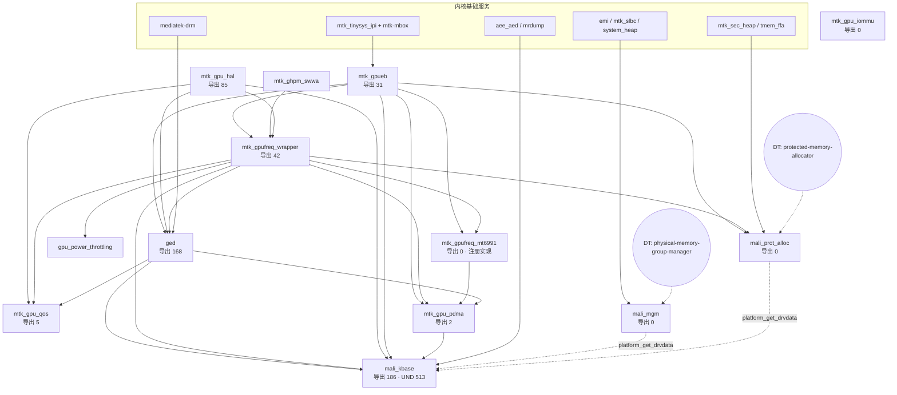
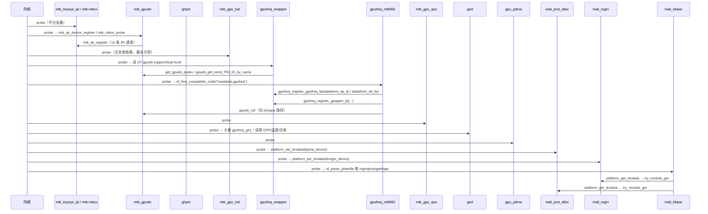

# MT6991 原厂 GPU 平台模块依赖关系审计

> 依据：`01_original_baseline/kernel_ref_mt6991/vendor_dlkm/` @ **r49p1-03bet0 出厂二进制作物**
> 对照：`01_original_baseline/mtk_kernel_modules/gpu/gpu_mali/mali_avalon/mali-r49p1/drivers/gpu/arm/midgard/` @ **r49p1-03bet0**（`Makefile:526`）
> 审计日期：2026-11-15 · 方式：ELF 静态解析（`.symtab` / `__versions` / `.modinfo` / `.rela.*`）+ 源码调用点交叉验证 · **未编译、未运行、未修改任何源码**

---

## 0. 必须先说明的证据边界

任务书要求"以仓库中已经归档的真实源码为准"，并指定检查 `01_original_baseline/mtk_kernel_modules/drivers/`。实测结果与这一前提不符，必须先纠正：

| 检查项 | 实测 | 结论 |
| --- | --- | --- |
| `mtk_kernel_modules/` 下有没有 `drivers/` | **没有**。该目录只有 `gpu/gpu_mali/mali_avalon/mali-r49p1`（581 文件） | MTK 平台层**没有以源码形式归档** |
| MTK 平台层的实际归档形态 | `kernel_ref_mt6991/vendor_dlkm/` 下 **15 个 `.ko`**，合计 4.13 MB | 只有二进制 |
| `.ko` 是否可分析 | `file` 全部返回 `not stripped`，**`.symtab` + `.strtab` + `__versions` 完整** | 符号级分析可行，且精度高于 `strings` 猜测 |
| `01_original_baseline/gpu_source_inventory.md` 记载的 MTK 源码位置 | `MiCode/MTK_kernel_modules @ fe0fa7ff` 的 `drivers/gpu/mediatek/**`，**当时按需拉到 `/tmp`，未入库** | 本仓库内**不可用** |

因此本报告的定位是：**以二进制符号为一等证据**（导出/未定义/重定位调用边/`__versions` CRC），以 r49p1 Kbase 源码为**调用方侧**的一等证据，两侧互证。凡是只能从二进制推断、无法落到源码行的判断，一律标注 `[推断]`；无法判定的标注 `UNKNOWN`。

**没有**用 `strings` 里的函数名去反推实现细节——那是任务书禁止的"仅凭名称推测"。

---

## 1. 方法：四条独立证据链

| # | 证据 | 提取方式 | 能回答什么 |
| --- | --- | --- | --- |
| E1 | 导入/导出符号 | `readelf -sW`，`__ksymtab_*` 识别导出、`UND` 识别导入 | 谁依赖谁、依赖哪些符号 |
| E2 | `modinfo.depends` | `readelf -p .modinfo` | 模块级依赖（不是符号级） |
| E3 | `__versions` | `readelf -x __versions`，条目 64 字节（`crc` 8 + `name` 56） | 编译时锁定的**内核符号 CRC**，证明 ABI 绑定对象 |
| E4 | 重定位调用边 | `readelf -rW` 的 `r_offset` 落在 `[st_value, st_value+st_size)` 内 | 函数级"谁调谁"，含本地跳转 |

E4 做了两点额外处理，否则会得出错误结论：

1. **符号大小不可忽略**。`__gpufreq_power_control` 的 `st_size` 只有 8 字节，机器码为 `52800020 d65f03c0`（`mov w0,#1` + `ret`），是一个**返回常量 1 的桩**。若不看 `st_size` 就把它当成"GPUFreq 上电实现"，会得出完全错误的架构判断。
2. **本地跳转无重定位**。同一 section 内的 `b`/`bl` 不产生 `R_AARCH64_*` 条目，只看重定位会漏掉全部静态函数调用。因此对函数体做了 `B/BL` 立即数解码（`opcode>>26 ∈ {0x05, 0x25}`，目标 = `pc + (imm26<<2)`），再按地址反查 `FUNC` 符号。

E4 的自校验：在 `mali_kbase_mt6991_r49.ko` 上取 `kbase_csf_protected_memory_init`，得到
`__of_parse_phandle_with_args` / `of_find_device_by_node` / `try_module_get` / `_dev_err` / `_dev_info`，
与 `csf/mali_kbase_csf_protected_memory.c:31-58` 源码逐项吻合。

---

## 2. 15 个模块的实测台账

加载序取 `kernel_ref_mt6991/modules.load.vendor` 行号。

| 序 | 模块 | 大小 (B) | 定义符号 | 未定义 | **导出** | `depends=` |
| ---: | --- | ---: | ---: | ---: | ---: | --- |
| 38 | `mtk_gpu_power_throttling.ko` | 38,288 | 91 | 27 | 0 | `mtk_low_battery_throttling,mtk_battery_oc_throttling,mtk_bp_thl,mtk_gpufreq_wrapper` |
| 43 | `mtk_gpueb.ko` | 128,560 | 159 | 72 | **31** | `mtk_tinysys_ipi,mtk-mbox` |
| 45 | `mtk_gpu_hal.ko` | 58,968 | 101 | 9 | **85** | （空） |
| 46 | `mtk_gpufreq_wrapper.ko` | 151,736 | 150 | 58 | **42** | `mtk_gpueb,mtk_gpu_hal,mtk_pbm,device-apc-common,mtk_ghpm_swwa,mtk_tinysys_ipi` |
| 47 | `mtk_gpufreq_mt6991.ko` | 118,368 | 134 | 31 | **0** | `mtk_gpufreq_wrapper,mtk_gpueb,mrdump` |
| 48 | `mtk_gpu_iommu_mt6991.ko` | 12,840 | 18 | 3 | 0 | （空） |
| 49 | `ged.ko` | 1,093,352 | 2,371 | 240 | **168** | `mtk_gpufreq_wrapper,mtk_gpu_hal,system_heap,mtk_gpu_qos,thermal_interface,mediatek-drm,mtk_gpueb,mtk_tinysys_ipi,sspm_v3` |
| 50 | `mtk_gpu_pdma_mt6991.ko` | 40,512 | 57 | 41 | **2** | `ged,mtk_gpueb,mtk_gpufreq_wrapper` |
| 51 | `mali_prot_alloc_mt6991_r49.ko` | 21,080 | 25 | 25 | **0** | `mtk_gpueb,mtk_gpufreq_wrapper,mtk_sec_heap,tmem_ffa` |
| 52 | `mali_mgm_mt6991_r49.ko` | 55,696 | 92 | 45 | **0** | `emi,system_heap,mtk_slbc` |
| 53 | `mali_kbase_mt6991_r49.ko` | 2,310,424 | 2,881 | **513** | **186** | `mtk_gpufreq_wrapper,aee_aed,ged,irq-dbg,mtk_gpu_hal,mrdump,mtk_gpueb,emi,mtk_sec_heap,tmem_ffa,mtk_slbc,mtk_gpu_pdma_mt6991` |
| 87 | `mtk_gpu_qos.ko` | 33,376 | 49 | 35 | **5** | `mtk_gpu_hal,mtk_gpufreq_wrapper,mtk_qos` |
| — | `met_gpu_api.ko` | 14,336 | 14 | 19 | 0 | `met,mtk_gpu_hal` |
| — | `met_gpu_adv_api.ko` | 12,184 | 14 | 9 | 0 | `met,mtk_gpu_hal` |
| — | `met_gpueb_api.ko` | 14,120 | 14 | 19 | 0 | `met,mtk_gpueb` |

三个 `met_*` 不在 GPU 加载链上（`met.ko` 是 MTK 性能分析框架，独立加载），与 GPU 运行时功能无关，仅提供 MET 采集接口。

### 2.1 关键异常：`modules.load.vendor` **不是**依赖有序的

`ged.ko`（第 49 行）对 `mtk_gpu_qos.ko`（第 87 行）存在**硬符号依赖**：

```
ged.ko UND: MTKGPUQoS_mode / MTKGPUQoS_mode_ratio / MTKGPUQoS_setup
mtk_gpu_qos.ko 导出: MTKGPUQoS_getBW / MTKGPUQoS_is_inited / MTKGPUQoS_mode / MTKGPUQoS_mode_ratio / MTKGPUQoS_setup
```

被依赖者在加载列表中**排在依赖者之后**。这说明该文件只是"清单"而非"执行序"——真正的顺序由 `depmod`/`modprobe` 的依赖解析决定，或由 `mtk_gpu_qos` 通过 `symbol_get` 运行时取符号（`ged.ko` 的 `UND` 里没有 `__symbol_get`，故排除后者）。

> **对移植的含义**：不能把 `modules.load.vendor` 的行号当作初始化顺序证据。本报告所有"先后"判断均以 `depends=` 与符号方向推导，不引用行号顺序。

---

## 3. 依赖拓扑

以 `depends=` 与未定义符号并集绘制。实线 = 硬符号依赖；虚线 = 设备模型绑定（无符号关系）。



读图要点：

- **`mali_kbase` 处在图的"汇"位置**：它向下依赖 5 个 MTK 模块（89 个符号），而这 5 个模块**没有一个**回指它。
- **MGM / PMA 是孤立节点**：符号上不依赖任何人、不导出任何符号；它们只通过 **DT phandle + `platform_get_drvdata`** 与 kbase 建立联系（第三章展开）。
- `mtk_gpufreq_mt6991` 导出数为 **0**，却是真正的频率/电压实现——它通过 `gpufreq_register_gpufreq_fp` 把函数表**注册进 wrapper**，属于"回调注册"而非"符号调用"。

---

## 4. 依赖方向定理：反向引用为 0

对 14 个 MTK 模块的 `UND` 全集做 `kbase` 子串与 `kbase_` 前缀双重匹配：

```
ged.ko                        0
mali_mgm_mt6991_r49.ko        0
mali_prot_alloc_mt6991_r49.ko 0
met_gpu_adv_api.ko            0
met_gpu_api.ko                0
met_gpueb_api.ko              0
mtk_gpu_hal.ko                0
mtk_gpu_iommu_mt6991.ko       0
mtk_gpu_pdma_mt6991.ko        0
mtk_gpu_power_throttling.ko   0
mtk_gpu_qos.ko                0
mtk_gpueb.ko                  0
mtk_gpufreq_mt6991.ko         0
mtk_gpufreq_wrapper.ko        0
────────────────────────────────
合计                          0
```

反向方向，`mali_kbase` 的 513 个 `UND` 中有 **89 个**由 MTK 模块提供：

| 提供方 | 符号数 | 代表符号 |
| --- | ---: | --- |
| `ged.ko` | **53** | `ged_dvfs_gpu_freq_commit_fp`、`ged_dvfs_set_gpu_core_mask_fp`、`ged_mali_event_update_gpu_reset_nolock`、`ged_kpi_get_target_fps`、`mtk_bandwidth_resource_init` |
| `mtk_gpufreq_wrapper.ko` | **16** | `gpufreq_power_control`、`gpufreq_commit`、`gpufreq_dual_commit`、`gpufreq_set_limit`、`gpufreq_bringup`、`gpufreq_get_cur_freq` |
| `mtk_gpu_hal.ko` | **13** | `mtk_notify_gpu_power_change`、`mtk_get_gpu_loading`、`mtk_get_gpu_pmu_init_fp`、`mtk_set_gpu_idle_fp` |
| `mtk_gpueb.ko` | **6** | `ghpm_ctrl`、`wait_gpueb`、`gpueb_dump_status`、`gpueb_get_mbox1_irq`、`gpueb_clr_mbox1_irq`、`dump_ghpm_info` |
| `mtk_gpu_pdma_mt6991.ko` | **1** | `pdma_lock_reclaim` |
| **合计** | **89** | |

**这条定理是 TASK 03 全部结论的地基**：MTK 平台层在编译期与链接期完全不知道 kbase 的存在。因此

> "能否保留 MTK 平台层" 的问题，**不是** "MTK 代码依赖了哪些 kbase 内部实现"，而是 "r56p0 的 kbase 里是否还有那 89 个调用点，且原型是否一致"。

---

## 5. 逐模块职责与可独立性判定

判定口径：**独立运行** = 不依赖 kbase 且不依赖 GPU 硬件即可完成 probe；**须依赖原厂 kbase** = 仅当 kbase 存在才有意义或才能 probe 成功。

| 模块 | 职责 | 关键导出 | 依赖 kbase？ | 判定 |
| --- | --- | --- | --- | --- |
| `mtk_gpueb` | GPU 电源协处理器驱动：mbox/IPI 注册、共享内存、GPR 访问、WFI 状态、看门狗 | `gpueb_ctrl`、`wait_gpueb`、`ghpm_ctrl`、`get_gpueb_ipidev` | **否** | **完全独立**，只依赖 `mtk_tinysys_ipi`/`mtk-mbox`；可原样保留 |
| `mtk_gpufreq_wrapper` | GPUFreq 门面：向 kbase/GED 暴露 42 个 API，内部按 `gpueb-support` 选择 AP 直写或 EB(IPI) 通道 | `gpufreq_power_control`、`gpufreq_commit`、`gpufreq_set_limit` | **否** | **完全独立**；可原样保留 |
| `mtk_gpufreq_mt6991` | MT6991 具体实现：PLL/MTCMOS/BUCK/VS RAM 寄存器序列、OPP 表、PPM 限幅 | 无（全部经 fp 注册） | **否** | **完全独立**；可原样保留 |
| `ged` | GPU 调度/功耗策略引擎：DVFS 负载计算、boost、FPSGO 对接、APO、白盒 | 168 个 `ged_*` | **否** | **完全独立**；可原样保留 |
| `mtk_gpu_hal` | 跨模块状态总线：freq/power 变更通知、loading、PMU、SWPM | 85 个 `mtk_*_fp` | **否** | 独立；可原样保留 |
| `mtk_gpu_qos` | GPU 带宽 QoS（原 `gpu_bm.c`） | `MTKGPUQoS_*` ×5 | **否** | 独立；可原样保留 |
| `mtk_gpu_pdma` | 页表 DMA 引擎（PTE 批量搬运） | `pdma_lock_reclaim`、`gpl` | **否**（但被 kbase 调用） | 独立；可原样保留 |
| `mtk_gpu_power_throttling` | 低电量/过流/温升限流，回调进 GPUFreq | 无导出 | **否** | 独立；可原样保留 |
| `mtk_gpu_iommu` | 为 PMA 下的 `gpu-iommu` / `gpu-iommu-protected` 两个子节点建 SMMU 域 | 无 | **否** | 独立（18 个符号、3 个外部依赖）；可原样保留 |
| `mali_mgm` | 内存分组管理：LP rank 池、PTE 改写（PBHA/SLC）、debugfs 调参 | **无导出** | **部分**（仅设备模型） | 需**适配** ops 表签名 |
| `mali_prot_alloc` | 受保护内存分配：dma-heap / secure handle / FFA | **无导出** | **部分**（仅设备模型） | ops 表与 r56p0 **完全一致**，**保留** |
| `mali_kbase` | Arm DDK 本体 | 186 | — | 必须重建 MTK 注入 |

### 5.1 五个必答问题

**Q1：哪些模块可以独立运行？**
除 `mali_kbase`、`mali_mgm`、`mali_prot_alloc` 以外的 **12 个**全部可独立运行。其中 `mtk_gpueb` / `mtk_gpufreq_*` / `ged` / `mtk_gpu_hal` / `mtk_gpu_qos` / `mtk_gpu_pdma` / `mtk_gpu_power_throttling` / `mtk_gpu_iommu` 共 8 个与 GPU 硬件控制直接相关，构成完整的"平台控制面"。

**Q2：哪些模块必须依赖原厂 kbase？**
**一个都没有**（第 4 章，反向引用 0）。存在的是"被 kbase 依赖"，方向相反。

**Q3：哪些模块实际上只依赖 MTK 平台接口？**
`mali_mgm`（只吃 `emi`/`mtk_slbc`/`system_heap` 与 DT）与 `mali_prot_alloc`（只吃 `mtk_gpueb`/`mtk_gpufreq_wrapper`/`mtk_sec_heap`/`tmem_ffa` 与 DT）最典型——它们的 `UND` 里没有任何 kbase 符号，纯靠 DT 节点被 kbase 发现。

**Q4：哪些模块可以原样保留（不重编、不改源）？**
严格说**没有**：15 个 `.ko` 的 `__versions` 都锁定在 `6.6.118-android15-8-g57e634f35c1b-4k` 的符号 CRC 上，换内核即全部失效（`vermagic` 也含同一串）。若限定为"源码不改、只需重编"，则 **12 个**可以（第 5 章表格），`mali_prot_alloc` 也算（ops 表一致），`mali_mgm` 需改 1 个函数签名。

**Q5：哪些模块必须修改才能与 r56p0 共存？**
只有两个，且改动量差异极大：

| 模块 | 必须改什么 | 改动性质 |
| --- | --- | --- |
| `mali_mgm` | `example_mgm_update_gpu_pte` 从 4 参数改 6 参数（新增 `pbha_id`、`pte_flags`）；补第 7 个 ops `mgm_get_import_memory_cached_access_permitted` | **函数签名 + 表项语义**，见 `04_mgm_pma_memory_audit.md` |
| `mali_prot_alloc` | **无需改源**，重新编译即可 | ops 表逐字节一致，见 `04` §3 |

---

## 6. 初始化与退出顺序（按符号依赖推导）



退出路径是上述的逆序，但有两个**不对称点**必须记录：

1. `kbase_csf_protected_memory_term()` 只做 `module_put(pma_dev->owner)`，**不清空** `kbdev->csf.pma_dev`（`csf/mali_kbase_csf_protected_memory.c:61-64`）。
2. MGM 侧同理，`try_module_get(kbdev->mgm_dev->owner)` 之后未见对称的 `module_put`（`mali_kbase_mem.c:336-345` 只有错误路径置 `NULL`）。

> `[推断]` 这两处不对称在"模块永不卸载"的量产配置下无害，但如果移植后需要 `rmmod` 调试，会造成引用计数泄漏。属 P3 观察项。

---

## 7. 异常恢复路径

| 场景 | 机制 | 证据 |
| --- | --- | --- |
| PMA 未就绪 | `platform_get_drvdata` 返回 `NULL` → 返回 `-EPROBE_DEFER`，kbase probe 重试 | `csf/mali_kbase_csf_protected_memory.c:45-49` |
| MGM 未就绪 | 同上，`-EPROBE_DEFER` | `mali_kbase_mem.c:334-338` |
| MGM 已就绪但模块取不到 | `try_module_get` 失败 → `-ENODEV` 且 `mgm_dev=NULL` | `mali_kbase_mem.c:339-343` |
| GPUEB 休眠失败 | `wait_gpueb(SUSPEND_POWER_ON)` 非 0 → `gpueb_dump_status()` + 返回错误，**不继续上电** | `platform/mt6991/mali_kbase_config_mt6991.c:265-271` |
| GHPM 失败 | `ghpm_ctrl(GHPM_ON,0)` 非 0 → `dump_pm_callback_kbase_info()` + `dump_ghpm_info()` | 同上 `:255-262` |
| GPU 上下电状态机异常 | `WARN_ON(kbdev->pm.backend.gpu_powered)`、`WARN_ON(!kbdev->pm.active_count)` 等 6 处断言 | 同上 `:226-243`、`:313-330` |
| 重复上电/下电 | `check_pm_callback_state()` 拦截，打印并返回 | 同上 `:253`、`:334` |

**这几处是"必须保留的语义"**：它们把 MTK 电源状态机的不变量（上电前必须未上电、下电前必须无活跃 CSG）显式编码成 `WARN_ON`。r56p0 的 `mali_kbase_runtime_pm.c` 完全没有对应断言，移植后这些不变量将无人守护。

---

## 8. UNKNOWN

| ID | 项 | 缺什么 |
| --- | --- | --- |
| U3-01 | `mtk_gpufreq_wrapper` 的 `platform_ap_fp` / `platform_eb_fp` 两张 72 字节表（9 项）的**逐项语义** | 无该模块源码；二进制只能看到函数指针值，不能看到字段名 |
| U3-02 | `ged.ko` 的 168 个导出中，kbase 只用了 53 个；剩余 115 个是否有被 kbase 通过**函数指针**间接使用 | 函数指针调用不产生 `UND`，ELF 无法证否 |
| U3-03 | `mtk_gpu_hal` 的 `_fp` 与同名非 `_fp` 版本（如 `mtk_get_gpu_loading` / `mtk_get_gpu_loading_fp`）的语义差异 | 同上 |
| U3-04 | `mtk_gpufreq_mt6991` 中 `platform_eb_fp`（416 字节 = 52 项）与 `platform_ap_fp`（72 字节 = 9 项）**项数不一致**的原因 | 无源码；推测前者是 OPP 相关表而非 ops 表 |
| U3-05 | 15 个模块是否全部启用 `CONFIG_MODULE_SIG` 强制签名校验 | 无出厂内核 `.config` |

---

## 9. 本报告对 Stage 2 的修正

| Stage 2 表述 | 本报告实测 | 处理 |
| --- | --- | --- |
| `06_blocking_issues.md` Q5："不存在干净切面，900 处注入在 Arm 核心文件内" | **结论成立，但理由需精确化**：真正的耦合不是"900 处引用"，而是 ① 89 个外部符号调用点、② **7 个 kbase 结构体里 45 个 `CONFIG_MALI_MTK_*` 字段块**（`kbase_device` 29、`kbase_context` 6、`kbase_mmu_debug_info` 5、`kbase_sub_alloc` 2、其余 3 个各 1）；后者才是不可机械迁移的部分 | 见 `06_platform_retention_matrix.md` §2 |
| `04_pm_interface_diff.md` KB-053："`platform/` 归零导致 MTK 适配全失" | 表述正确但**范围偏窄**：`platform/` 只是 MTK 注入的一部分，`mtk_platform_common/` 下的 devfreq governor、logbuffer、dvfs_hint 等 42 个文件才是策略主体 | 见 `03_ged_integration_audit.md` §4 |
| `03_memory_mmu_diff.md` KB-041："MGM 97 处注入归零" | **计数需换算**：97 是源码内 `CONFIG_MALI_MTK_*` 相关行数；MGM 模块实际只有 **92 个定义符号**、**45 个外部依赖**，其中 MTK 专有的是 `mtk_mgm_pool_*`（4 个）、`mtk_fetch_page`、`mtk_refill_work_handler`、`MTKAllocPage`、`mgmm_cache_pool_size` | 见 `04` §2 |
