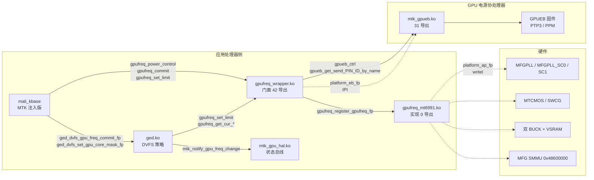

# GPUFreq / GPUEB 架构与调用链还原

> 依据：`01_original_baseline/kernel_ref_mt6991/vendor_dlkm/{mtk_gpueb,mtk_gpufreq_wrapper,mtk_gpufreq_mt6991}.ko` @ **r49p1-03bet0**
> 硬件描述：`kernel_ref_mt6991/dtb/mt6991.dtb`（Android DT-Table 封装，内层 FDT 532,258 B / 2,194 节点）
> 调用方：`…/mali-r49p1/drivers/gpu/arm/midgard/platform/mt6991/mali_kbase_config_mt6991.c` @ **r49p1-03bet0**
> 方式：ELF 重定位调用边 + DT 属性解码 + 源码逐行对读 · 未编译、未运行

---

## 0. 结论先行

| # | 结论 | 强度 |
| --- | --- | --- |
| 1 | GPUFreq 是**两层结构**：`mtk_gpufreq_wrapper`（门面，42 个导出）+ `mtk_gpufreq_mt6991`（实现，**0 个导出**，靠 `gpufreq_register_gpufreq_fp` 把函数表注册进 wrapper） | `[实证]` |
| 2 | 频率可以被两条通路写：**AP 直写**（AP 侧 `writel` MFGPLL/MTCMOS/BUCK 寄存器）与 **EB 卸载**（IPI 送到 GPUEB 执行）。选择由 DT `gpueb-support` 决定，本机为 `1` | `[实证]`（DT + 符号） |
| 3 | GPUEB 与 AP 之间有 **12 条 IPI 通道**，其中 `IPI_ID_FAST_DVFS`(7)、`IPI_ID_GPUFREQ`(1)、`IPI_ID_FAST_DVFS_EVENT`(0) 与调频直接相关 | `[实证]` |
| 4 | 上电顺序被 GPUEB 强耦合：`ghpm_ctrl(GHPM_ON)` → `wait_gpueb(SUSPEND_POWER_ON)` → `gpufreq_power_control(GPU_PWR_ON)`，任一失败即终止上电 | `[实证]` |
| 5 | **不需要重写 GPUFreq**。kbase 只通过 **16 个符号**接触 GPUFreq，且这 16 个符号全部属于 wrapper 的稳定门面 | `[实证]` |
| 6 | 真正需要重建的是 `mt6991.c` 里那 4 个回调函数（`pm_callback_power_on/off`、`pm_callback_suspend/resume`）以及 GHPM 分支 | `[实证]` |

---

## 1. 组件拓扑



`mtk_gpufreq_mt6991.ko` 的 123 个定义符号里，寄存器基址全局变量占了一大片，直接证明它是"寄存器序列执行者"而非"策略者"：

```
g_mfg_top_base / g_mfg_pll_base / g_mfg_pll_sc0_base / g_mfg_pll_sc1_base
g_mfg_rpc_base / g_mfg_smmu_base / g_mfg_vcore_ao_cfg_base / g_mfg_vcore_bus_trk_base
g_mfg_vgpu_bus_trk_base / g_mfg_eb_bus_trk_base / g_mfg_hbvc_base
g_cksys_base / g_emi_infra_cfg_base / g_emi_infra_ao_mem_base
g_sth_emicfg_ao_mem_base / g_nth_emicfg_ao_mem_base
```

与 DT `/soc/gpufreq@48500000` 的 `reg` 五段一一对应：

| `reg-names` | 基址 | 大小 | 用途 |
| --- | --- | --- | --- |
| `mfg_top_config` | `0x48500000` | `0x00100000` | MFG 顶层配置（含 `TOP_BASE`，见源码 `:46`） |
| `mfg_smmu` | `0x48600000` | `0x00200000` | **MFG SMMU 归属 GPUFreq**，不是 kbase |
| `mfg_vgpu_bus_trk` | `0x48800000` | `0x00100000` | vGPU 总线 tracker |
| `mfg_gpueb_bus_...` | `0x4b190000`(截断) | — | GPUEB 总线 tracker |

> `[实证]` 这一条直接回答"IOMMU 归属"：**GPU 的 SMMU 寄存器由 GPUFreq 管**，`/soc/iommu@48600000` 则由通用 `arm-smmu-v3` 驱动接管（见 `05_dts_hardware_resource_audit.md` §5）。两者是同一块硬件的不同视角。

---

## 2. IPI 通道：从 DT 表解码

`/soc/gpueb@4b000000` 的 `send-table` / `recv-table` 是 `(ipi_id, slot, size)` 三元组数组，`*-name-table` 是 NUL 分隔字符串。解码结果：

| IPI ID | 名称 | send 载荷 | 与本任务关系 |
| ---: | --- | ---: | --- |
| 0 | `IPI_ID_FAST_DVFS_EVENT` | 4 B | **事件上报**（GPUEB→AP 方向为主，见 recv-table 中 6 处 slot） |
| 1 | `IPI_ID_GPUFREQ` | 8 B | **调频请求主通道** |
| 2 | `IPI_ID_SLEEP` | 3 B | 休眠/唤醒握手 |
| 3 | `IPI_ID_TIMER` | 6 B | 时间同步 |
| 4 | `IPI_ID_FHCTL` | 9 B | 跳频（FHCTL）控制 |
| 5 | `IPI_ID_CCF` | 4 B | 时钟控制框架代理 |
| 6 | `IPI_ID_GPUMPU` | 6 B | GPU MPU（保护域） |
| 7 | `IPI_ID_FAST_DVFS` | 6 B | **快速调频（fast DVFS）** |
| 8 | `CH_IPIR_C_MET` | 1 B | MET 采集 |
| 9 | `CH_IPIS_C_MET` | 4 B | MET 采集 |
| 10 | `IPI_ID_BRISKET` | 4 B | 温控 |
| 11 | `IPI_ID_PPB` | 1 B | PPB |

`recv-table` 中 `IPI_ID_GPUFREQ` 出现 **6 次**（slot 0/1/2/5/8/11），`IPI_ID_FAST_DVFS_EVENT` 出现 **5 次**（slot 0/1/4/6/8）——说明同一 IPI 通道用 slot 复用多路上下文，不是单一请求-应答。

`gpueb-mem-table` 只声明两块共享内存：`MEM_ID_GPUFREQ`（`0x4000` = 16 KB）、`MEM_ID_LOG`（`0x180000` = 1.5 MB）。**调频共享数据只有 16 KB**，可推断高频路径靠 IPI 载荷而非共享内存传参。

> `UNKNOWN`：`send-name-table` 与 `recv-name-table` 内容完全相同，无法从 DT 判断方向。方向性来自 `mtk_gpueb` 的 `mtk_ipi_register` 调用参数，而该模块无源码。

---

## 3. 上电 / 下电：逐行还原

以下全部来自 `platform/mt6991/mali_kbase_config_mt6991.c`（r49p1，775 行）。行号实测可 `sed -n 'Np'` 复核。

### 3.1 上电（`CONFIG_MALI_MTK_GHPM_STAGE1_ENABLE=y` 主路径）

```
pm_callback_power_on(kbdev)                                    :217
├─ spin_lock(hwaccess_lock)                                    :226
├─ WARN_ON(kbdev->pm.backend.gpu_powered)                      :237   ← 不变量①
├─ WARN_ON(!kbdev->pm.active_count)                            :240   ← 不变量②
├─ WARN_ON(kbdev->pm.runtime_active)                           :241   ← 不变量③
├─ mutex_lock(&kbdev->ghpm_lock)                               :248
├─ check_pm_callback_state(GED_POWER_ON)                       :253   ← 去重
│    ret!=0 → dump_pm_callback_kbase_info() + 返回              :281-282
├─ ghpm_ctrl(GHPM_ON, 0)                                       :255
│    失败 → dump_pm_callback_kbase_info() + dump_ghpm_info()    :258-259
├─ wait_gpueb(SUSPEND_POWER_ON)                                :265
│    失败 → gpueb_dump_status(NULL,NULL,0) + 返回               :268-270
├─ mutex_lock(&g_mfg_lock)                                     :274
├─ pm_callback_power_on_nolock(kbdev)                          :275
│   ├─ mtk_common_gpufreq_bringup() ? → mfg_active + return 0   :123-126
│   ├─ !gpufreq_power_ctrl_enable() ? → mfg_active + return 0   :128-134
│   ├─ mtk_common_pm_is_mfg_active() ? → return 0               :136-137
│   ├─ mtk_common_ged_dvfs_write_sysram_last_commit_top_idx()    :146
│   ├─ mtk_common_ged_dvfs_write_sysram_last_commit_dual()       :147
│   ├─ gpufreq_power_control(GPU_PWR_ON)                        :150   ★核心
│   │    失败 → KBASE_PLATFORM_LOGE + return 1                  :151-152
│   ├─ mtk_common_pm_mfg_active()                               :158
│   └─ ged_dvfs_gpu_clock_switch_notify(GED_POWER_ON)           :163
├─ mtk_notify_gpu_power_change(1)                               :276
└─ mutex_unlock ×2                                             :277,284
```

### 3.2 下电

```
pm_callback_power_off(kbdev)                                   :295
├─ WARN_ON(kbdev->pm.backend.gpu_powered)                      :323
├─ WARN_ON(kbase_csf_scheduler_get_nr_active_csgs(kbdev))      :326   ← 不变量④
├─ WARN_ON(kbdev->pm.backend.mcu_state != KBASE_MCU_OFF)        :327   ← 不变量⑤
├─ mutex_lock(&kbdev->ghpm_lock)                               :333
├─ check_pm_callback_state(GED_POWER_OFF)                      :334
├─ mutex_lock(&g_mfg_lock)                                     :337
├─ mtk_notify_gpu_power_change(0)                              :338   ← 先通知再断电
├─ pm_callback_power_off_nolock(kbdev)                         :339
│   ├─ mtk_common_pm_mfg_idle()                                :197
│   ├─ gpufreq_power_control(GPU_PWR_OFF)                      :209   ★核心
│   └─ 失败 → KBASE_PLATFORM_LOGE + return（**不断电但仍解锁**）  :210-212
├─ mutex_unlock(&g_mfg_lock)                                   :387
├─ ghpm_ctrl(GHPM_OFF, 0)                                      :391
└─ wait_gpueb(SUSPEND_POWER_OFF)                               :400
```

### 3.3 不变量清单（移植时必须保留）

| # | 断言 | 行号 | 含义 |
| ---: | --- | ---: | --- |
| ① | `WARN_ON(gpu_powered)` | `:237` | 上电前必须是"未上电" |
| ② | `WARN_ON(!active_count)` | `:240` | 上电时必须有活跃引用 |
| ③ | `WARN_ON(runtime_active)` | `:241` | 上电时 runtime PM 必须是 inactive |
| ④ | `WARN_ON(nr_active_csgs)` | `:326` | 下电前必须无活跃 CSG |
| ⑤ | `WARN_ON(mcu_state != KBASE_MCU_OFF)` | `:327` | 下电前 MCU 必须已关 |

r56p0 的 `platform/devicetree/mali_kbase_runtime_pm.c` **一条都没有**。这不是"少了几行日志"，而是**少了一套状态机断言**：移植后若 MTK 电源序列出错，将静默进入不一致状态而非 `WARN` 报警。

---

## 4. 调频路径

### 4.1 谁在算，谁在写

| 角色 | 做什么 | 证据 |
| --- | --- | --- |
| `ged.ko` | 算负载、算目标频点、下发限幅 | 导出 29 个 `ged_dvfs_*`；`UND` 含 20 个 `gpufreq_*`（含 `gpufreq_set_limit`、`gpufreq_get_cur_freq`、`gpufreq_get_dynamic_power`） |
| `gpufreq_wrapper` | 保存限幅、仲裁、在安全点提交 | 导出 `gpufreq_set_limit` / `gpufreq_commit` / `gpufreq_dual_commit` |
| `gpufreq_mt6991` | 真正写 PLL/MTCMOS/BUCK | 定义 `__gpufreq_generic_commit_gpu` / `_dual` / `_stack`、`__gpufreq_set_sel_bit` / `_delsel_bit` |
| `gpueb` | EB 模式下代为执行 | 导出 `gpueb_ctrl`、`ghpm_ctrl` |

**关键观察**：`ged.ko` 的 `UND` 里**没有** `gpufreq_commit`，只有 `gpufreq_set_limit`。而 `mali_kbase` 的 `UND` 里**有** `gpufreq_commit`。

> `[推断]` 因此调频是"两段式"：GED 用 `gpufreq_set_limit()` **登记目标**，kbase 在合适的同步点调用 `gpufreq_commit()` **落盘**。这样避免了在任意上下文里直接改 PLL。
> 支持这一推断的旁证：`gpufreq_set_limit` 在 wrapper 里只引用 `.bss`（限幅表）+ `_raw_spin_lock_irqsave`，**没有任何 IPI 或寄存器访问**；`gpufreq_commit` 同样只碰 `.bss` 与锁——两者都是"记账"，真正落盘在 fp 回调内。
> `UNKNOWN`：无法从二进制确认 commit 的确切触发点（可能在 `pm_callback_power_on` 之后、或 kbase 的 `kbase_pm_context_active` 内）。

### 4.2 `GPUPWR` 的三种取值路径

`pm_callback_power_on_nolock` 的三个提前返回分支说明 MTK 定义了三种"上电"语义：

| 条件 | 动作 | 语义 |
| --- | --- | --- |
| `mtk_common_gpufreq_bringup()` | 只置 `mfg_active`，**不调用** `gpufreq_power_control` | bringup 阶段：由 bootloader/GPUEB 预先开电，kbase 不重复上电 |
| `!gpufreq_power_ctrl_enable()` | 同上，但额外通知 GED `GED_POWER_ON` | GPUFreq 未接管电源（如低配 SKU/仿真） |
| `mtk_common_pm_is_mfg_active()` | 直接返回 0 | 幂等保护 |
| 正常 | `gpufreq_power_control(GPU_PWR_ON)` | 真实上电 |

DT `/gpufreq-wrapper` 的 `gpufreq-bringup = 0` 表明本机走**正常路径**，即每次 `pm_callback_power_on` 都会真的调 `gpufreq_power_control`。

---

## 5. OPP 表：52 项，26 MHz 等步长

来源：`/soc/opp-table0`（`phandle 0x166`，被 `mali@48000000` 的 `operating-points-v2` 引用）。`opp-hz` 为 **8 字节**大端 u64，`opp-microvolt` 为 4 字节 u32。

| 档位 | 频率 (MHz) | 电压 (mV) |
| ---: | ---: | ---: |
| opp00 | **1612** | 880 |
| opp01 | 1586 | 870 |
| opp02 | 1560 | 865 |
| opp03 | 1534 | 860 |
| opp04 | 1508 | 850 |
| … | 每档 −26 | 单调递减 |
| opp44 | 468 | 540 |
| opp45 | 442 | 535 |
| opp46 | 416 | 525 |
| opp47 | 390 | 520 |
| opp48 | 365 | 510 |
| opp49 | 338 | 500 |
| opp50 | 338 | 500 |
| opp51 | 338 | 500 |

三个要点：

1. **最高 1612 MHz**，不是 `gpu_source_inventory.md` 记的 1.508 GHz。1508 是 `opp04`，不是顶点。以 DTB 为准。
2. **末三档重复 338 MHz**：`opp49/50/51` 同频同压。`[推断]` 这是双 BUCK 场景下的占位（`dual-buck = 1`），或为"关核保底档"预留多个索引位。`UNKNOWN`：无法从 DTB 确认语义。
3. OPP 表**只在 DT 里**，GPUFreq 模块从 `of_property_read_*` 读取（`mtk_gpufreq_mt6991` 的 `UND` 含 `of_property_read_variable_u32_array`，出现 4 次）。因此 OPP 表**不随 kbase 版本变化**，属于可保留资产。

---

## 6. 错误处理与超时

| 机制 | 位置 | 行为 |
| --- | --- | --- |
| GHPM 上电失败 | `mt6991.c:255-262` | 打印 + `dump_pm_callback_kbase_info()` + `dump_ghpm_info()`，返回错误，**不继续** |
| GPUEB 唤醒超时 | `mt6991.c:265-271` | `wait_gpueb(SUSPEND_POWER_ON)` 非 0 → `gpueb_dump_status()`，返回错误 |
| GPUFreq 上电失败 | `mt6991.c:150-153` | `KBASE_PLATFORM_LOGE("Power On Failed")` → `return 1` |
| GPUFreq 下电失败 | `mt6991.c:209-212` | 打印后 `return`，**但仍会执行 `ghpm_ctrl(OFF)`**（`mutex_unlock` 在 `:387`） |
| 重复上/下电 | `mt6991.c:253/334` | `check_pm_callback_state()` 拦截 + dump |
| DSU 请求重入 | `mt6991.c:739` | `BUG_ON(1)` —— 重复请求直接崩 |
| GPUEB 看门狗 | `gpueb` 导出 `gpueb_trigger_wdt` | 由 GPUEB 侧触发 |

`wait_gpueb` 的超时时长**未在 DTB 暴露**，`[UNKNOWN]` 该值硬编码于 `mtk_gpueb.ko` 内。

DT 里另有三个超时相关属性，可直接读取：

| 属性 | 值 | 含义 |
| --- | ---: | --- |
| `default-glb-pwroff-timeout-us` | `0x0a` = 10 | 全局断电等待 |
| `firmware-idle-hysteresis-time-us` | `0` | 固件 idle 迟滞，本机禁用 |
| `autosuspend-delay-ms` | `0x0a` = 10 | runtime PM 自动挂起延时 |

---

## 7. kbase 与 GPUFreq 的全部接触面：16 个符号

| 符号 | kbase 用途（源码落点） |
| --- | --- |
| `gpufreq_power_control` | `mt6991.c:150`（`GPU_PWR_ON`）、`:209`（`GPU_PWR_OFF`） |
| `gpufreq_power_ctrl_enable` | `mt6991.c:128`、`:178` 判断是否接管电源 |
| `gpufreq_bringup` | 经 `mtk_common_gpufreq_bringup()` 包装，`mt6991.c:123`、`:175` |
| `gpufreq_commit` | kbase 侧同步点提交目标频点 |
| `gpufreq_dual_commit` | 双 BUCK 同步提交 |
| `gpufreq_set_limit` | 提交限幅（热/电/系统） |
| `gpufreq_set_mfgsys_config` | `mt6991.c:345/348/351/362/364/367/368` —— `CONFIG_PTP3` 映射级别 |
| `gpufreq_get_cur_freq` | 上报当前频率 |
| `gpufreq_get_cur_oppidx` | OPP 索引 |
| `gpufreq_get_cur_volt` | 电压 |
| `gpufreq_get_freq_by_idx` | 索引→频率 |
| `gpufreq_get_shader_present` | 上核掩码 |
| `gpufreq_dump_infra_status` | 异常 dump |
| `gpufreq_dump_infra_status_logbuffer` | 异常 dump（logbuffer 版） |
| `gpufreq_get_dynamic_power` | 动态功耗（IPA/SWPM） |
| `gpufreq_get_leakage_power` | 漏电功耗 |

**这 16 个全部是 wrapper 的导出，全部在 `__ksymtab` 里，全部是函数指针调用的门面。** 没有任何一个触及 `mtk_gpufreq_mt6991` 的内部结构。

---

## 8. 判断：R56p0 是否需要重新实现 GPUFreq？

**不需要。** 三条理由，逐条给证：

**理由一：GPUFreq 与 kbase 没有共享数据结构。**
`mtk_gpufreq_wrapper` 的 58 个 `UND` 里，指向 kbase 的为 **0 个**；指向 kbase 头文件的类型也不存在（它只 include `<mtk_gpufreq.h>` 这类自有头）。反方向，kbase 用到的 16 个符号全是"标量进、标量出"的函数。没有结构体跨界。

**理由二：GPUFreq 的输入全部来自 DT，不来自 kbase。**
`mt6991` 模块的 `UND` 里 `of_find_compatible_node` ×4、`of_property_read_variable_u32_array` ×4、`platform_get_resource_byname` ×34、`devm_ioremap` ×34 —— 它自给自足地从 DT 拿寄存器与 OPP。

**理由三：调用点数量有限且集中在少数文件。**
实测各目录 `gpufreq_*` 词元出现次数：

| 目录 | 次数 | 出现位置 |
| --- | ---: | --- |
| `platform/` | 184 | `mt6991.c` 与 `mtk_platform_common/` 的主体 |
| `backend/` | 10 | `pm_driver.c` ×7（`power_control` 4、`set_mfgsys_config` 3）、`gpuprops_backend.c` ×2、`devfreq.c` ×1 |
| `csf/` | 1 | `ipa_control/mali_kbase_csf_ipa_control.c`（`gpufreq_get_cur_freq`） |
| `mmu/` `device/` `gpu/` `hw_access/` | **0** | — |

> **必须注意**：`backend/gpu/mali_kbase_pm_driver.c:525-526`、`:555-556` 出现的是 `mtk_set_gpufreq_clock_parking*`，属于 `mtk_` 前缀的包装，**不是** `gpufreq_*` 符号。用 `grep 'gpufreq_'` 会把它算进去（14 次），用 `grep -E '\bgpufreq_'` 才是 10 次。本报告统一采用后者。

### 8.0 一个必须讲清的口径问题：源码标识符 18 ≠ 链接符号 16

| 口径 | 数量 | 说明 |
| --- | ---: | --- |
| 源码中出现的 `gpufreq_*` 标识符 | **18** | `grep -rEho '\bgpufreq_[a-z0-9_]+' --include=*.c --include=*.h` |
| 真正进入 `mali_kbase_mt6991_r49.ko` 的 `UND` | **16** | `readelf -sW` + 集合运算 |
| 源码有、链接无 | **2**：`gpufreq_check_bus_idle`、`gpufreq_set_ocl_timestamp` | 被 `#if` 排除（对应 `CONFIG_MALI_MTK_MFGSYS_PM` 等未启用项） |

**这就是"源码 grep 会高估接口面"的直接证据。** 判断移植工作量时，应以 `UND` 集合为准；`grep` 只能用来定位调用点。后文 §7 的 16 符号表即由此得出，与源码侧逐一对应，无遗漏、无多余。

### 8.1 需要重建的清单（不是"重写 GPUFreq"，是"重建 kbase 侧的调用方"）

| 需重建项 | 原位置 | 在 r56p0 的落点 |
| --- | --- | --- |
| `pm_callbacks` 全局结构体 | `mt6991.c:641-652` | r56p0 有 `kbase_pm_callback_conf`（12 成员**完全一致**），需重新提供一份 MTK 版 |
| `mtk_platform_pm_init/term` | `mt6991.c:654/690` | r56p0 的 `kbase_platform_init/term` 钩子 |
| 上/下电 4 个回调 | `mt6991.c:217/295/633/625` | 同上 |
| GHPM 分支 | `mt6991.c:247-290`、`:332-419` | **无对应**，需整段新增 |
| `sleep-mode-enable` 的 6 个 runtime PM 回调注册 | `mt6991.c:666-678` | 无对应；DT 本机为 `1`，**必须注册** |
| PTP3 / `gpufreq_set_mfgsys_config` 的 API sync 逻辑 | `mt6991.c:340-386` | 无对应 |
| DSU SMC 请求（`arm_smccc_smc`） | `mt6991.c:725-729`、`:748-752` | 无对应 |

**工作量估算（不含调试）**：`mali_kbase_config_mt6991.c` 775 行中，与 GPUFreq/GPUEB/GHPM 直接相关约 **430 行**（`:119-421` + `:641-694`），需要整体移植并按 r56p0 的回调签名调整。

---

## 9. UNKNOWN

| ID | 项 | 缺什么 |
| --- | --- | --- |
| U3-06 | `gpufreq_register_gpufreq_fp` 接收的结构体字段布局 | 无 wrapper 源码；`platform_ap_fp` 72 B=9 项、`platform_eb_fp` 72 B=9 项（另一处 416 B 同名项语义不明） |
| U3-07 | `wait_gpueb` 的超时阈值与重试次数 | 硬编码在 `mtk_gpueb.ko` |
| U3-08 | `gpufreq_commit` 的实际触发点（谁在什么上下文调） | kbase 侧 `UND` 有该符号，但 MTK 注入的 `csf/` 调度器内调用点未逐一定位 |
| U3-09 | `IPI_ID_FAST_DVFS` 与 `IPI_ID_GPUFREQ` 的分工边界 | 无 GPUEB 固件与源码 |
| U3-10 | GHPM 的 `GHPM_ON/OFF` 与 `Vcore-off-allow` 状态机细节 | 无 `ghpm_wrapper` 源码；仅知 `ghpm-supply = <0xac>` → `/soc/ghpm@4b800000` |
