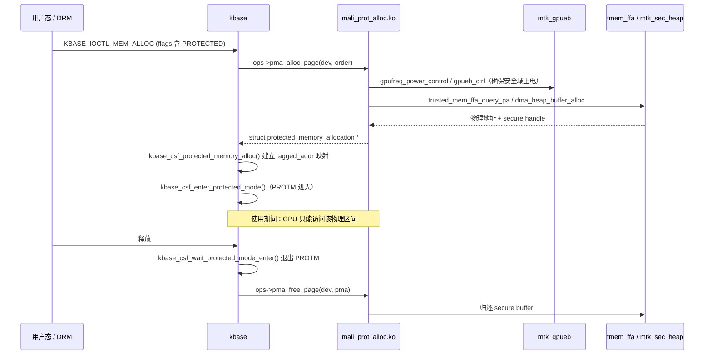

# MGM / PMA 内存体系审计

> 依据：`kernel_ref_mt6991/vendor_dlkm/{mali_mgm_mt6991_r49,mali_prot_alloc_mt6991_r49}.ko` @ **r49p1-03bet0**
> 头文件：`…/midgard/include/linux/{memory_group_manager.h,protected_memory_allocator.h}` vs `02_r56_source/mali_r56p0/driver/product/kernel/include/linux/` 同名文件
> 绑定代码：`mali_kbase_mem.c`（MGM）、`csf/mali_kbase_csf_protected_memory.c`（PMA）
> 方式：结构体逐字对读 + ELF 符号 + DTS 属性 · 未编译、未运行

---

## 0. 结论先行

| # | 结论 | 强度 |
| --- | --- | --- |
| 1 | MGM 与 PMA **不通过符号与 kbase 连接**。二者都**零导出符号**，靠 DT phandle + `platform_get_drvdata()` 被 kbase 取到 | `[实证]` |
| 2 | `memory_group_manager_ops` **两版都是 7 项**，但**第 7 项语义变了**：MTK 的 `mgm_mtk_cache_pool_size` → Arm 的 `mgm_get_import_memory_cached_access_permitted`。**大小相同（56 B）、无编译期报错、无运行时检查** | `[实证]` |
| 3 | `mgm_update_gpu_pte` 从 **4 参数**变 **6 参数**（新增 `pbha_id`、`pte_flags`），这是唯一会被编译器抓住的破坏 | `[实证]` |
| 4 | `protected_memory_allocator_ops` **逐字节相同**；`protected_memory_allocator_device` **逐字节相同**；`csf/mali_kbase_csf_protected_memory.c` **两版各 155 行、4,463 字节、去注释后 diff 为空** | `[实证]` |
| 5 | MTK 早已在私有实现里做了 PBHA 编码（`PTE_PBHA_SHIFT=59`、`MASK=0xf`），r56p0 的 `pbha_id` 参数是**把这个私有约定正式化**。适配方向是"把自算改成入参"，不是重写逻辑 | `[实证]` + `[推断]` |
| 6 | **PMA 侧：SVP 保留路径成立**（见 §4）。**MGM 侧：必须改签名 + 重排 ops 表**（见 §2） | `[实证]` |

---

## 1. 绑定机制：DT phandle，不是符号

### 1.1 MGM

```c
/* mali_kbase_mem.c —— r49p1 */
:319    kbdev->mgm_dev = &kbase_native_mgm_dev;                    /* 默认用 Arm 原生实现 */
:322-325  mgm_node = of_parse_phandle(kbdev->dev->of_node,
                        "physical-memory-group-manager", 0);
:327-329  if (mgm_node) { pdev = of_find_device_by_node(mgm_node); }
:334        kbdev->mgm_dev = platform_get_drvdata(pdev);           /* ← 取 ops 表指针 */
:336        if (!try_module_get(kbdev->mgm_dev->owner)) { ... }    /* 引用计数 */
:341        未就绪 → err = -EPROBE_DEFER（:337）
```

### 1.2 PMA

```c
/* csf/mali_kbase_csf_protected_memory.c —— r49p1（r56p0 同） */
:31-32  pma_node = of_parse_phandle(kbdev->dev->of_node,
                        "protected-memory-allocator", 0);
:39     pdev = of_find_device_by_node(pma_node);
:45       kbdev->csf.pma_dev = platform_get_drvdata(pdev);
:48       未就绪 → -EPROBE_DEFER
```

### 1.3 r56p0 的 phandle 名**没有改**

| 属性名 | r49p1 | r56p0 |
| --- | --- | --- |
| `physical-memory-group-manager` | `mali_kbase_mem.c:322` | `mali_kbase_mem.c:261` |
| `protected-memory-allocator` | `protected_memory.c:31` | `protected_memory.c:35` |

> **正面结论**：DTS 里这两个 phandle **不需要改**。MGM/PMA 的设备树节点在原位即可被 r56p0 发现。这消除了"改 DTS"的一项风险。

但 `platform_get_drvdata()` 拿到的是 **`struct memory_group_manager_device *`**，其第一个成员就是 `struct memory_group_manager_ops ops;`。**结构体布局一变，取到的函数指针就全错位**——这正是下一节的问题。

---

## 2. MGM：ops 表逐项对比（核心）

### 2.1 表项对照

行号实测：

| 版本 | `struct memory_group_manager_ops` 范围 | `mgm_*` 字段数 | 关键行 |
| --- | --- | ---: | --- |
| r49p1 | `include/linux/memory_group_manager.h` | **7** | `:192` = `mgm_mtk_cache_pool_size`（`#if CONFIG_MALI_MTK_MGMM` 内） |
| r56p0 | 同上 `:67` … `:224` | **7** | `:221` = `mgm_get_import_memory_cached_access_permitted` |

| # | r49p1 字段 | 签名 | # | r56p0 字段 | 签名 | 判定 |
| ---: | --- | --- | ---: | --- | --- | --- |
| 0 | `mgm_alloc_page` | `(dev, group_id, gfp, order)` | 0 | `mgm_alloc_page` | 同 | ✅ 一致 |
| 1 | `mgm_free_page` | `(dev, group_id, page, order)` | 1 | `mgm_free_page` | 同 | ✅ 一致 |
| 2 | `mgm_get_import_memory_id` | `(dev, import_data)` | 2 | `mgm_get_import_memory_id` | 同 | ✅ 一致 |
| 3 | `mgm_update_gpu_pte` | `(dev, group_id, mmu_level, pte)` | 3 | `mgm_update_gpu_pte` | **`(dev, group_id, pbha_id, pte_flags, mmu_level, pte)`** | ❌ **4→6 参数** |
| 4 | `mgm_pte_to_original_pte` | `(dev, group_id, mmu_level, pte)` | 4 | `mgm_pte_to_original_pte` | 同 | ✅ 一致 |
| 5 | `mgm_vmf_insert_pfn_prot` | `(dev, group_id, vma, addr, pfn, pgprot)` | 5 | `mgm_vmf_insert_pfn_prot` | 同 | ✅ 一致 |
| 6 | **`mgm_mtk_cache_pool_size`**<br/>（`#if CONFIG_MALI_MTK_MGMM`）<br/>`size_t (*)(dev)` | | 6 | **`mgm_get_import_memory_cached_access_permitted`**<br/>`bool (*)(dev, import_data)` | | ❌ **语义替换** |

### 2.2 为什么第 6 项比第 3 项更危险

第 3 项（`update_gpu_pte`）参数从 4 个变 6 个，**编译器会报错**，改代码时一定会被发现。

第 6 项不会：

- `#if CONFIG_MALI_MTK_MGMM` 在原厂构建里**是开启的**。证据：`mali_mgm_mt6991_r49.ko` 的符号表里有 `mgmm_cache_pool_size`（LOCAL FUNC，offset `0x19c4`，28 字节）。
- 所以原厂 `ops` 结构体**就是 7 项 = 56 字节**；r56p0 也是 **7 项 = 56 字节**。
- `sizeof(struct memory_group_manager_device)` 两版都等于 `56 + 8(data) + 8(owner) = 72`。
- **没有任何 size/version 校验会发现差异。**

若把旧 MGM 重新编译后配到 r56p0 上，kbase 会这样调用：

```
kbase 认为 ops[6] 是: bool f(dev, import_data)
实际二进制里是:        size_t mgmm_cache_pool_size(dev)      /* 只读 dev，忽略 x1 */
```

AArch64 调用约定下第 2 个参数放 `x1`，被忽略不致命；返回值 `size_t`（例如 65536）被当 `bool` 解读 → **非 0 → "允许缓存访问 = true"**。

后果：对**本来不该缓存的导入内存**（如 CPU-uncached / GPU-cached 的 MMA 违规页）判定为"允许缓存"，导致**静默的数据一致性问题**，而且只在特定 dma-buf 导入路径上出现。

> 这类错误不会 panic、不会 WARN、不会打印。属于本审计认为**最需要显式防护**的一处：移植时必须在 `kbase_mem.c` 里加编译期断言，或用 `static_assert(sizeof(ops) == 7 * sizeof(void*))` 之外的手段（比如把 MTK 的 `mgm_mtk_cache_pool_size` 主动实现到新槽位上并返回 `false`）。

### 2.3 新增的 `enum mgm_pte_flags`

```c
/* r56p0 include/linux/memory_group_manager.h:49-51 */
enum mgm_pte_flags {
	MMA_VIOLATION = 0,      /* Mismatched Memory Attributes：CPU-uncached + GPU-cached */
};
```

`pte_flags` 是位图，当前只有 `BIT(0) = MMA_VIOLATION`。传参语义：

> 当 `pte_flags` 带 `MMA_VIOLATION` 时，集成商**可以**选择把 `pbha_id` 编进 PTE —— 但**仅当** NONCACHEABLE 的 `SYSC_PHBA_OVERRIDE` 需要时才这么做。

这条注释直接来自 Arm 的头文件，说明 `pbha_id` 与 `MMA_VIOLATION` 是**组合语义**，不能分开处理。

---

## 3. PMA：几乎零改动

### 3.1 ops 表逐字节相同

| # | 字段 | 签名 | r49p1 | r56p0 |
| ---: | --- | --- | --- | --- |
| 0 | `pma_alloc_page` | `(dev, order)` → `struct protected_memory_allocation *` | ✔ | ✔ |
| 1 | `pma_get_phys_addr` | `(dev, pma)` → `phys_addr_t` | ✔ | ✔ |
| 2 | `pma_free_page` | `(dev, pma)` → `void` | ✔ | ✔ |

`struct protected_memory_allocator_device { ops; owner; }` 也逐字相同。

### 3.2 header 的唯一差异

`protected_memory_allocator.h` 117 行（r49p1）vs 106 行（r56p0）。去注释后 diff 只有一处：

```c
#if IS_ENABLED(CONFIG_MALI_MTK_GPU_PMA_PAGE_HEAP)
struct dma_buf_info {
	struct dma_buf *buf;
	struct dma_buf_attachment *buf_attachment;
	struct sg_table *sgt;
};
#endif
...
#if IS_ENABLED(CONFIG_MALI_MTK_GPU_PMA_PAGE_HEAP)
	struct dma_buf_info dma_info;      /* 加在 struct protected_memory_allocation 里 */
#endif
```

**注意**：`dma_info` 加在 `protected_memory_allocation`（**分配对象**）里，不是加在 `_device`（ops 容器）里。所以：

- ops 表布局不受影响 → kbase 调用不会错位
- 但 `struct protected_memory_allocation` 的**大小**变了。这个结构体由 PMA 模块 `alloc` 出来、由 kbase 持有指针（不透明）、由 PMA `free` 掉。**只要 kbase 不解引用其内部字段，大小变化无害。**

验证：`grep -rn 'protected_memory_allocation' midgard/` 中，kbase 只把它当 `struct protected_memory_allocation **` 指针数组传递，从不访问成员。→ **安全**。

### 3.3 `mali_kbase_csf_protected_memory.c` 完全一致

```
r49p1: 155 行 / 4,463 字节
r56p0: 155 行 / 4,463 字节
diff（去注释去空行）: 无输出
```

这解决了 Stage 2 的一个悬而未决项：**受保护内存的"用法"两版完全一致，只有"来源"（PMA 模块实现）不同。** 因此 SVP 迁移的关键不在 kbase 侧，只在 PMA 模块能否重新编译。

### 3.4 SVP 生命周期



证据链：

| 环节 | 证据 |
| --- | --- |
| `pma_alloc_page` 被 kbase 调用 | `csf/mali_kbase_csf_protected_memory.c:73`（`pma_dev->ops.pma_alloc_page(...)`） |
| PMA 访问 GPUEB | `mali_prot_alloc` 的 `UND` 含 `gpueb_ctrl`、`gpufreq_power_control`、`gpufreq_active_sleep_control` |
| PMA 访问安全内存 | `UND` 含 `dma_heap_buffer_alloc`、`dmabuf_to_secure_handle`、`is_support_secure_handle`、`trusted_mem_ffa_query_pa` |
| PMA 有独立子设备 | DT `/protected-memory-allocator/{gpu-iommu, gpu-iommu-protected}`，`compatible = "mediatek,gpu-iommu"` |
| PROTM 进出 | kbase 定义 `kbase_csf_enter_protected_mode`、`kbase_csf_wait_protected_mode_enter`、`kbase_pm_protected_mode_enable/disable` |

---

## 4. PBHA：MTK 早已在做，r56p0 只是把它变成入参

### 4.1 原厂私有约定

```c
/* r49p1 include/linux/memory_group_manager.h:37-44 */
#define PTE_PBHA_SHIFT (59)
#define PTE_PBHA_MASK  ((uint64_t)0xf << PTE_PBHA_SHIFT)   /* 4 bit */

#if IS_ENABLED(CONFIG_MALI_MTK_SLC_ALL_CACHE_MODE)
#define GPU_ONLY_PBHA    6
#define GPU_TO_OVL_PBHA  7
#define GPU_TLS_PBHA     9
#endif
```

### 4.2 DTS 侧的佐证

```
/soc/mali@48000000/pbha
    propagate-bits = <0x0f>          ← 4 bit，与 PTE_PBHA_MASK 的 0xf 完全对应
```

DT 节点名 `pbha` 挂在 mali 下面，说明 **PBHA 是 GPU 节点的固有属性**，由 Mali 侧决定传播哪几位。

### 4.3 结论

| 维度 | r49p1 | r56p0 |
| --- | --- | --- |
| PBHA 值来源 | MGM 内部按 SLC 策略自算（`GPU_ONLY_PBHA` 等） | 由 kbase 作为 `pbha_id` **参数**传入 |
| PTE 写入位置 | MGM 在 `update_gpu_pte` 里自己移位写入 bit 59..62 | 同，但值来自参数 |
| 传播位宽 | `0xf` | 不变（DT 不改） |

> **适配动作**：把 MTK 的 `example_mgm_update_gpu_pte` 从"自己决定 PBHA"改成"用传入的 `pbha_id`"，并把原来算 SLC 策略的那段搬到一个**上层调用点**（kbase 侧决定 pbha_id 的地方）。逻辑本身不重写。

---

## 5. EMI rank：双 rank 才启用 mGMM 与页表聚类

```c
/* mali_kbase_mem.c —— r49p1 */
:357  #if CONFIG_MALI_MTK_MGMM
:358    if (mtk_emicen_get_rk_cnt() == 2)
:359        kbase_mem_pool_group_config_set_max_size(&mem_pool_defaults, 0x0);
        /* 双 rank → 关掉 kbdev 级 mem pool，池子交给 mGMM 管 */
:375  #if CONFIG_MALI_MTK_PAGE_TABLE_CLUSTERING
:376    if (mtk_emicen_get_rk_cnt() == 2) {
:377        kbdev->rank_boundary = MTK_EMI_DRAM_OFFSET + mtk_emicen_get_rk_size(0);
:378        kbdev->pt_clustering_enable = true;
        } else {
            kbdev->rank_boundary = MTK_EMI_DRAM_OFFSET;
            kbdev->pt_clustering_enable = false;
        }
```

`MTK_EMI_DRAM_OFFSET = ARCH_PFN_OFFSET << PAGE_SHIFT`（`mali_kbase_mem.h:51`）。

**这套逻辑依赖两个外部符号**：`mtk_emicen_get_rk_cnt()`、`mtk_emicen_get_rk_size()`。它们是 `mali_mgm` 的 `UND`（来自 `emi` 基础模块），**不在 kbase 的 89 个 MTK 依赖里**——说明 EMI 接口是 MGM 独享的，kbase 只通过 `mgm_dev` 间接用。

> `[推断]` 若 MGM 不移植，这 13 处 `mtk_emicen_*` / `CONFIG_MALI_MTK_MGMM` 分支会全部消失，kbase 回到 Arm 原生内存池策略：**单池、无 rank 边界、无页表聚类**。功能可用，性能受影响（大头在页表 TLB miss 与 rank 交错）。

---

## 6. 资源生命周期对比

| 资源 | 创建 | 销毁 | r49p1 与 r56p0 差异 |
| --- | --- | --- | --- |
| `mgm_dev`（含 ops） | MGM 模块 probe，`platform_set_drvdata` | `module_put(owner)`，**未清零指针** | 一致（同为 `mali_kbase_mem.c`） |
| `pma_dev` | PMA 模块 probe，`platform_set_drvdata` | `module_put(owner)`，**未清零指针**（`protected_memory.c:61-64`） | 一致 |
| `struct protected_memory_allocation` | `pma_alloc_page` | `pma_free_page` | 结构体大小不同（MTK 多 `dma_info`），但 kbase 不透明使用 → 兼容 |
| 页表（PTE） | `kbase_mmu_insert_pages` → 每页调 `mgm_update_gpu_pte` | `kbase_mmu_teardown` | **调用签名不同**（4→6 参数） |
| `mgm` 内存池 | MGM 模块私有（`mtk_mgm_pool_fill/flush`） | `shrinker`（`register_shrinker` / `unregister_shrinker`） | r56p0 无此机制 |
| 安全域 | `tmem_ffa` / `mtk_sec_heap` | 随 PMA 释放 | 一致 |

**两个"未清零"是已知的 P3 问题**，在模块不卸载的量产场景下无害，但会妨碍 `rmmod` 调试。

---

## 7. 判定

| 模块 | 能否原样保留 | 需改动 | 难度 |
| --- | --- | --- | --- |
| `mali_prot_alloc`（PMA） | ✅ **源码不改，重新编译** | 无 | **低** |
| `mali_mgm`（MGM） | ❌ | ① `example_mgm_update_gpu_pte` 加 2 参数；② 补 `mgm_get_import_memory_cached_access_permitted`；③ 决定 `mgm_mtk_cache_pool_size` 是保留（需另开槽位）还是废弃 | **中** |

### 7.1 对 Stage 2 结论的修正

| Stage 2（`03_memory_mmu_diff.md`） | 本报告实测 |
| --- | --- |
| KB-040："`mgm_update_gpu_pte` 签名破坏，P0" | **成立**，但应补充：真正的 P0 是**第 7 槽位语义替换**（无编译器保护） |
| KB-042："MTK 的 `mgm_mtk_cache_pool_size` 丢失槽位" | **表述不准**。槽位没丢，是**被同名同长的另一函数顶替**。二者都占 7 项，`sizeof` 相同 |
| KB-043："PMA 归零，SVP 必须重写" | **部分不成立**。PMA 的 ops 与 device 结构逐字相同，`protected_memory.c` 两版完全相同。**SVP 路径保留，不需重写** |

---

## 8. UNKNOWN

| ID | 项 | 缺什么 |
| --- | --- | --- |
| U3-16 | `example_mgm_update_gpu_pte`（92 字节）内部如何用 `group_id` 选择 SLC 策略 | 无源码；只能看到它很短 |
| U3-17 | `mgmm_cache_pool_size` 的返回值语义与消费者 | kbase 侧只有 `kbase_native_mgm.c:162` 置 `NULL`，**没有任何调用点**——说明该槽位在原厂 kbase 里也是死代码 |
| U3-18 | `CONFIG_MALI_MTK_GPU_PMA_PAGE_HEAP` 是否启用 | 无法从 `.ko` 判断（`dma_buf_info` 只在结构体里，无独立符号） |
| U3-19 | `rank_boundary` 在两版的功能等价物 | r56p0 无 `rank_boundary` 字段，页表聚类能力是否完全丧失需实机测量 |
